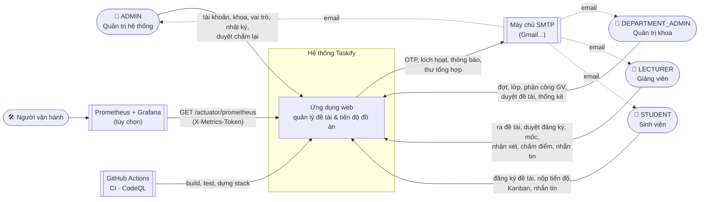
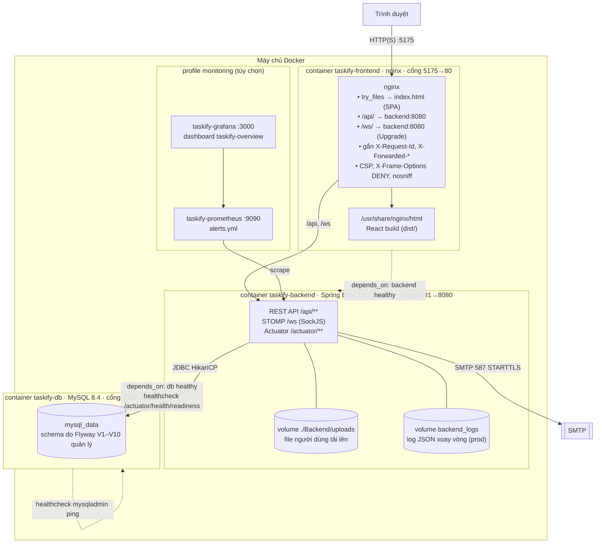
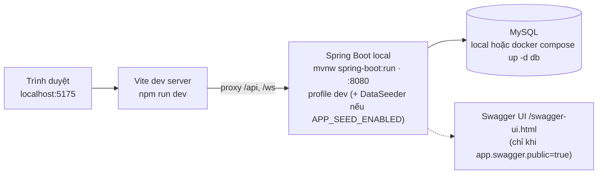
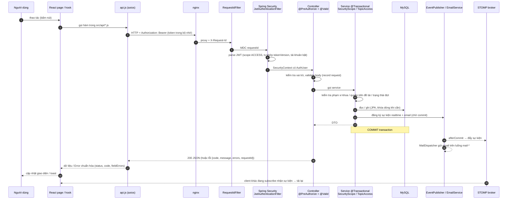
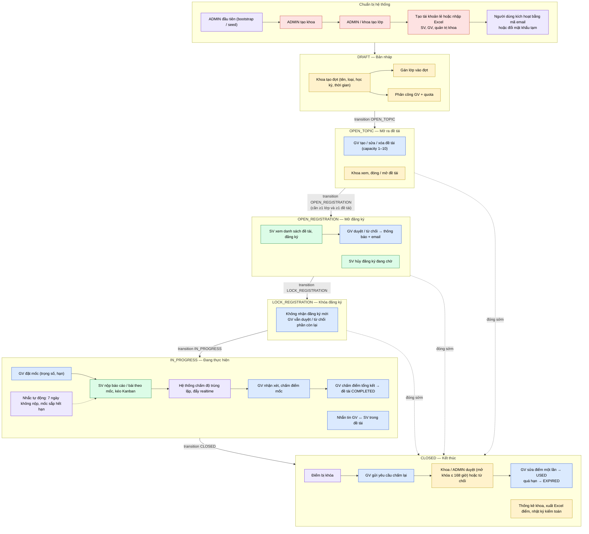

# 01 — Tổng quan hệ thống

[← Mục lục](README.md)

## 1.1 Sơ đồ ngữ cảnh (ai dùng hệ thống, hệ thống nói chuyện với ai)

## 1.2 Sơ đồ triển khai (Docker Compose)

**Thứ tự khởi động:** `db` (healthy) → `backend` chạy Flyway migrate, `AdminBootstrap`, `StoredFileMaintenance.backfill`, (dev) `DataSeeder` → readiness `UP` → `frontend`.

**Biến bắt buộc** (không có giá trị mặc định, thiếu thì compose từ chối chạy): `JWT_SECRET`, `MYSQL_PASSWORD`, `MYSQL_ROOT_PASSWORD`. Tạo bằng `scripts/init-env.ps1`.

## 1.3 Chế độ phát triển (không Docker)

Script hỗ trợ: `scripts/run-backend.ps1`, `scripts/run-frontend.ps1`, `scripts/get-otp.ps1 <user>` (lấy OTP demo từ DB), `scripts/smoke-test.mjs`, `scripts/ui-check*.mjs` (Playwright), `scripts/pre-demo-check.ps1`.

## 1.4 Đường đi của một request REST (từ đầu tới cuối)

## 1.5 Luồng lớn nhất — vòng đời trọn một đợt đồ án

Sơ đồ này nối mọi chức năng lại theo đúng thứ tự diễn ra trong thực tế. Chi tiết từng bước ở các file 04–10.

## 1.6 Công nghệ

| Lớp | Công nghệ |
|---|---|
| Frontend | React 19, Vite, Tailwind CSS, React Router, axios, `@stomp/stompjs` + `sockjs-client` (tải lười), Vitest + Testing Library, ESLint (React Compiler, `--max-warnings 0`) |
| Backend | Java 21, Spring Boot 3.5 (Web, Security, Data JPA, Validation, WebSocket, Mail, Actuator), JJWT (HS256), Flyway, Apache POI (Excel), Micrometer Prometheus, springdoc OpenAPI, JaCoCo, Testcontainers |
| Dữ liệu | MySQL 8.4, thời gian lưu UTC, ứng dụng chạy giờ `Asia/Ho_Chi_Minh` |
| Hạ tầng | Docker Compose (db, backend, frontend, + prometheus, grafana), nginx, GitHub Actions (CI, CodeQL) |
