# 02 — Kiến trúc Backend (Spring Boot 3.5 · Java 21)

[← Mục lục](README.md)

Gói gốc: `Backend/src/main/java/com/doanltmmt/Backend`.

## 2.1 Phân tầng

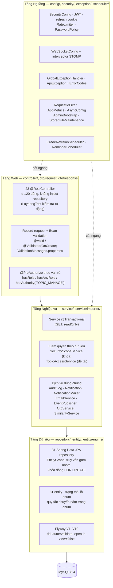

## 2.2 Bản đồ module: Controller → Service → Repository

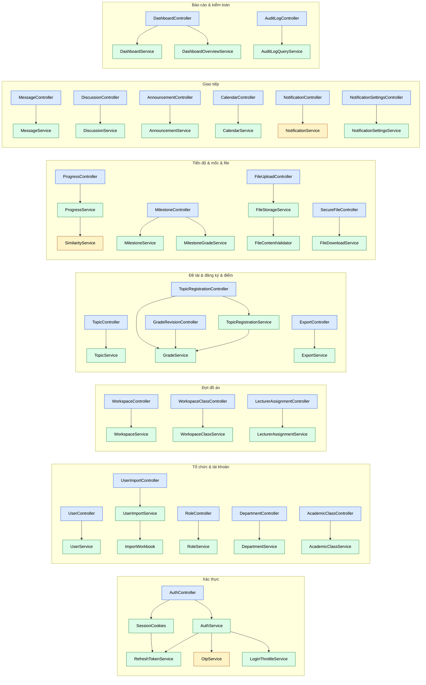

Các service dùng chung (màu vàng) được gọi từ hầu hết service nghiệp vụ:

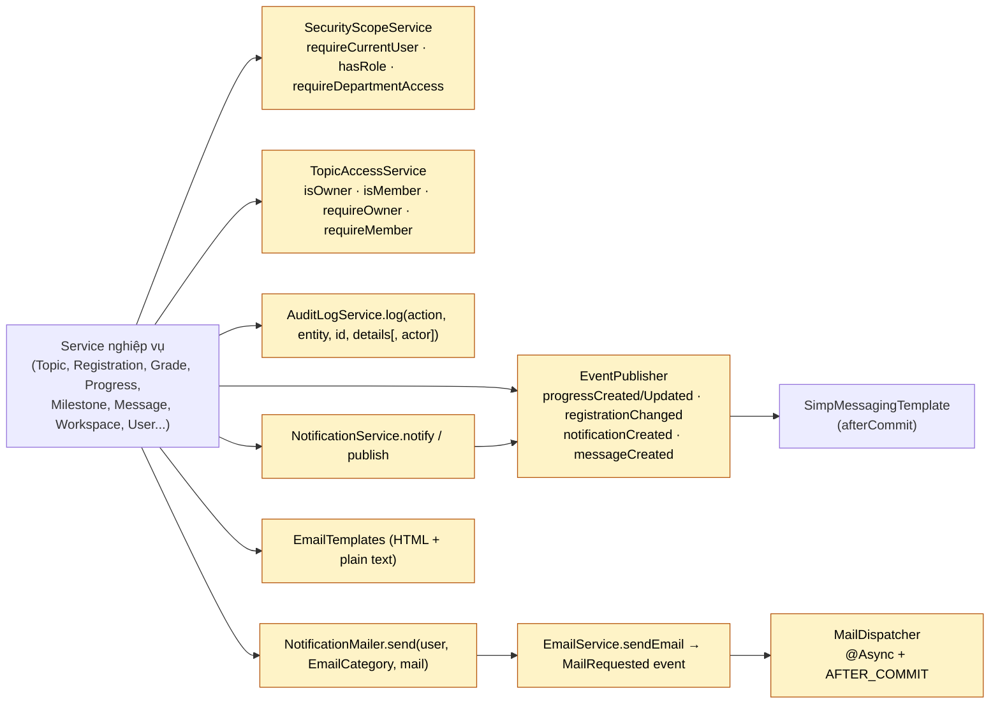

## 2.3 Chuỗi filter bảo mật HTTP

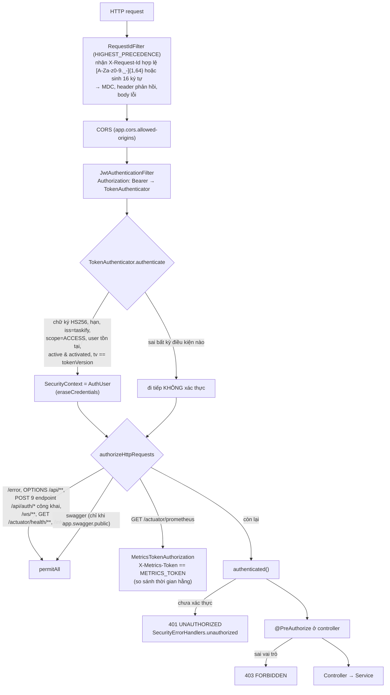

`csrf` tắt vì API dùng header Bearer (không dùng session/cookie). Riêng cookie refresh có chống CSRF riêng: `SameSite=Strict` + kiểm tra `Origin` (`RefreshCookie.requireSameOrigin`). `sessionCreationPolicy = STATELESS`.

## 2.4 Ba lớp phân quyền

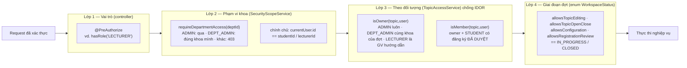

### Ma trận vai trò (rút gọn theo nhóm endpoint)

| Nhóm | ADMIN | DEPARTMENT_ADMIN | LECTURER | STUDENT |
|---|:-:|:-:|:-:|:-:|
| Tài khoản (`/users` tạo, khóa, đổi vai trò) | ✔ | — | — | — |
| Danh sách người dùng theo khoa, nhập Excel | ✔ | ✔ (khoa mình) | — | — |
| Vai trò & quyền, khoa, nhật ký kiểm toán | ✔ | — | — | — |
| Lớp, đợt, gán lớp, phân công GV | ✔ | ✔ (khoa mình) | — | — |
| Tạo / sửa / đóng-mở đề tài | ✔ | ✔ (khoa mình) | ✔ (đề tài của mình, quyền `TOPIC_MANAGE`) | — |
| Duyệt / từ chối đăng ký, chấm điểm, gửi yêu cầu chấm lại | — | — | ✔ (đề tài của mình) | — |
| Duyệt yêu cầu chấm lại | ✔ | ✔ (khoa mình, không tự duyệt) | — | — |
| Đăng ký / hủy, nộp tiến độ, Kanban | — | — | — | ✔ (của mình) |
| Nhận xét tiến độ, mốc, lịch, thông báo theo đề tài | ✔ | (xem) | ✔ (đề tài của mình) | (xem nếu đã duyệt) |
| Tin nhắn, thảo luận | thành viên đề tài | thành viên đề tài | thành viên đề tài | thành viên đề tài |
| Dashboard | admin, overview | department-admin, overview | lecturer | student |
| Hồ sơ, thông báo, cài đặt email, tải file | ✔ | ✔ | ✔ | ✔ |

Quyền (privilege) mặc định từ migration V2: `USER_MANAGE`, `ROLE_MANAGE`, `DEPT_MANAGE`, `TOPIC_MANAGE`, `REGISTRATION_MANAGE`, `SYSTEM_REPORT`. Mã nguồn hiện chỉ kiểm tra trực tiếp `TOPIC_MANAGE` (ở `TopicController`); các quyền khác mang tính mô tả, phân quyền thực tế dựa vào vai trò.

## 2.5 Kiến trúc realtime (STOMP over SockJS)

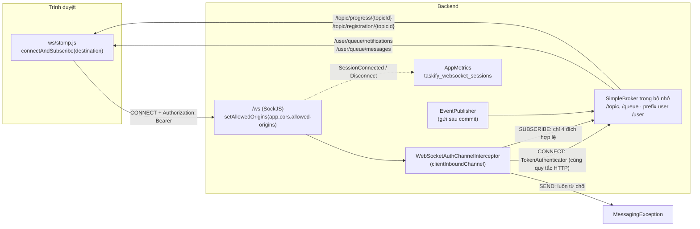

| Kênh | Kiểm tra khi SUBSCRIBE | Sự kiện | Nơi phát |
|---|---|---|---|
| `/user/queue/notifications` | chính người dùng (định tuyến theo Principal) | `NOTIFICATION_CREATED` | `NotificationService.publish` |
| `/user/queue/messages` | chính người dùng | `MESSAGE_CREATED` (gửi cho cả người gửi và người nhận) | `MessageService.send` |
| `/topic/progress/{id}` | `TopicAccessService.isMember` | `PROGRESS_CREATED`, `PROGRESS_UPDATED` | `ProgressService.create/updateStatus/addComment` |
| `/topic/registration/{id}` | `TopicAccessService.isOwner` | `REGISTRATION_CREATED`, `REGISTRATION_UPDATED`, `REGISTRATION_CANCELLED` | `TopicRegistrationService` |

## 2.6 Kiến trúc gửi email

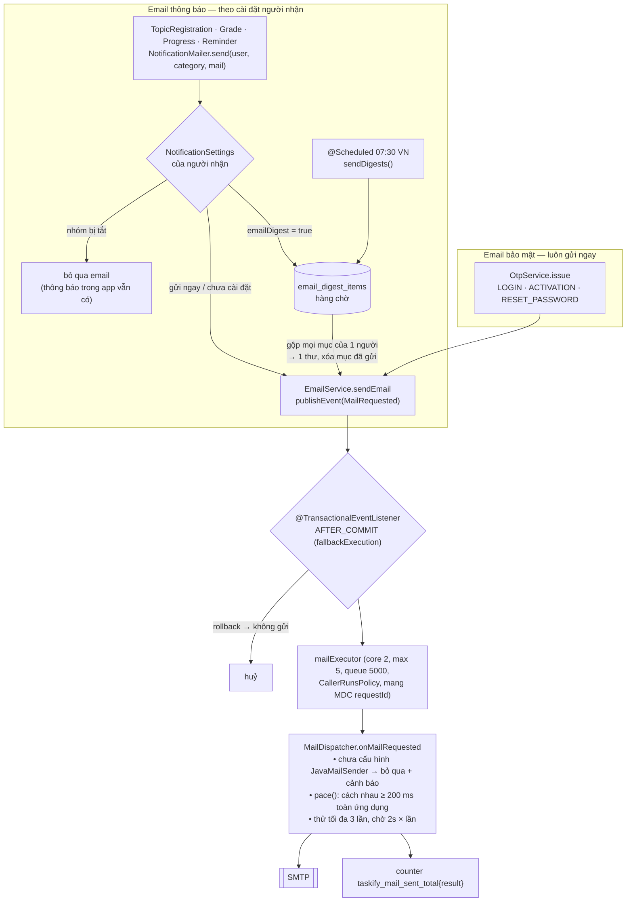

Nhóm email (`EmailCategory`): `REGISTRATION` (kết quả đăng ký), `PROGRESS` (báo cáo & nhận xét), `GRADE` (điểm & chấm lại), `REMINDER` (nhắc hạn tự động).

## 2.7 Phát sự kiện sau commit

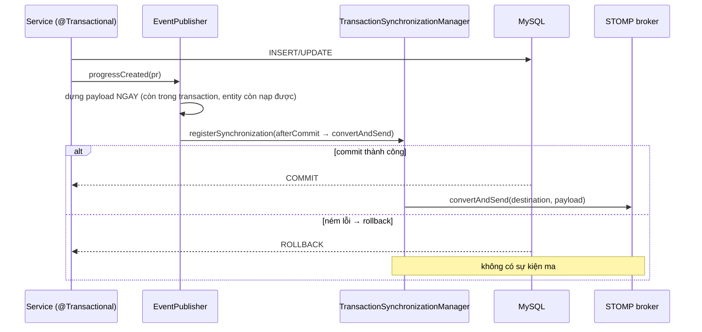

## 2.8 Job định kỳ

```mermaid
gantt
  title Lịch job @Scheduled trong một ngày (giờ Việt Nam)
  dateFormat HH:mm
  axisFormat %H:%M
  section Dọn dẹp đêm
  Xóa bộ đếm đăng nhập hết hạn (03h15) :03:15, 10m
  Xóa refresh token cũ > 30 ngày (03h30) :03:30, 10m
  Xóa file mồ côi > 24 giờ (03h30) :03:30, 10m
  Xóa nhật ký > 12 tháng, giữ GRADE_ (03h45) :03:45, 10m
  section Thông báo buổi sáng
  Thư tổng hợp email (07h30) :07:30, 10m
  Nhắc hạn mốc — còn 2 ngày / hết hạn hôm nay (08h00) :08:00, 10m
  Nhắc báo cáo — 7 ngày chưa nộp (09h00) :09:00, 10m
  section Lặp lại
  Hết hạn mở khóa điểm (phút 05 mỗi giờ) :00:05, 5m
```

| Job | Lớp | Lịch | Việc làm |
|---|---|---|---|
| Dọn cửa sổ rate limit | `RateLimiter.evictExpired` | mỗi 60 giây | xóa cửa sổ đã hết hạn trong RAM |
| Hết hạn chấm lại | `GradeRevisionScheduler` → `GradeService.expireOverdue` | `0 5 * * * *` | `APPROVED` quá `unlockUntil` → `EXPIRED`, báo GV |
| Nhắc hạn mốc | `ReminderScheduler.remindMilestoneDeadlines` | 08:00 VN | WARNING trước 2 ngày, CRITICAL đúng ngày |
| Nhắc báo cáo | `ReminderScheduler.remindWeeklyProgress` | 09:00 VN | SV 7 ngày chưa nộp, chống nhắc trùng |
| Thư tổng hợp | `NotificationMailer.sendDigests` | 07:30 VN | 1 thư / người |
| Bộ đếm đăng nhập | `LoginThrottleService.cleanUp` | 03:15 | xóa bộ đếm hết ý nghĩa |
| Refresh token | `RefreshTokenService.cleanup` | 03:30 | xóa token hết hạn/thu hồi quá 30 ngày |
| File mồ côi | `StoredFileMaintenance.purgeOrphans` | 03:30 | file chưa gắn báo cáo sau 24 giờ |
| Nhật ký | `AuditLogQueryService.purgeExpired` | 03:45 | xóa > 12 tháng, giữ nhật ký điểm |

Chạy một lần khi khởi động (`ApplicationRunner`): `AdminBootstrap` (tạo ADMIN đầu tiên), `StoredFileMaintenance.backfill` (tạo hồ sơ file cho báo cáo cũ), `DataSeeder` (chỉ profile `dev` + `APP_SEED_ENABLED=true`).

## 2.9 Xử lý lỗi

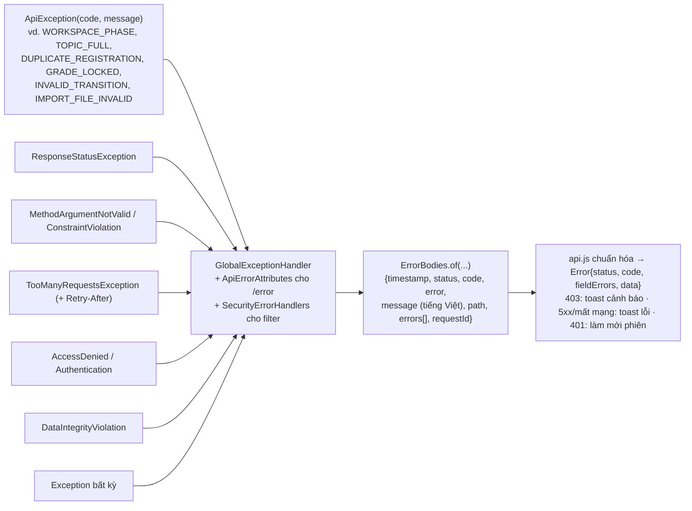

| Ngoại lệ | HTTP | `code` |
|---|---|---|
| Validation body | 400 | `VALIDATION_FAILED` (kèm `errors[]` theo trường) |
| JSON sai, thiếu tham số, sai kiểu | 400 | `MALFORMED_REQUEST` |
| `IllegalArgumentException`, `ClassCastException` | 400 | `INVALID_INPUT` |
| Trùng khóa / vi phạm ràng buộc | 409 | `DATA_CONFLICT` |
| Lỗi nghiệp vụ | 400 | mã riêng như bảng trên |
| Không xác định | 500 | `INTERNAL_ERROR` (không lộ stacktrace / SQL) |

## 2.10 Quan sát hệ thống

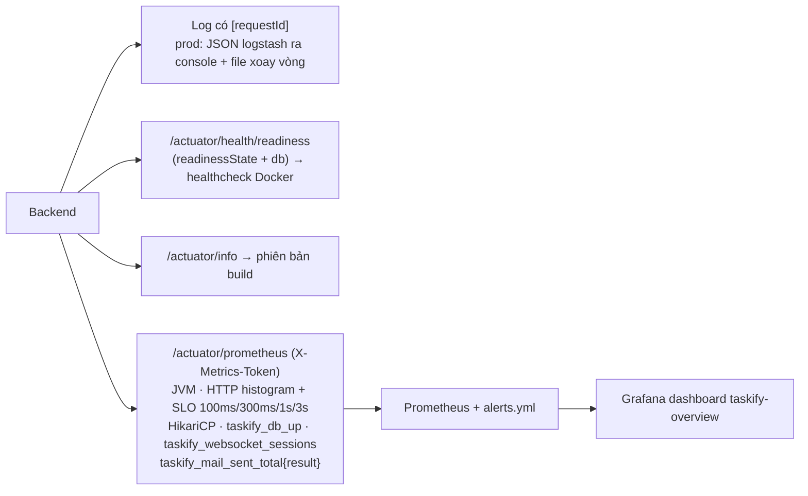

## 2.11 Mô hình dữ liệu (ERD)

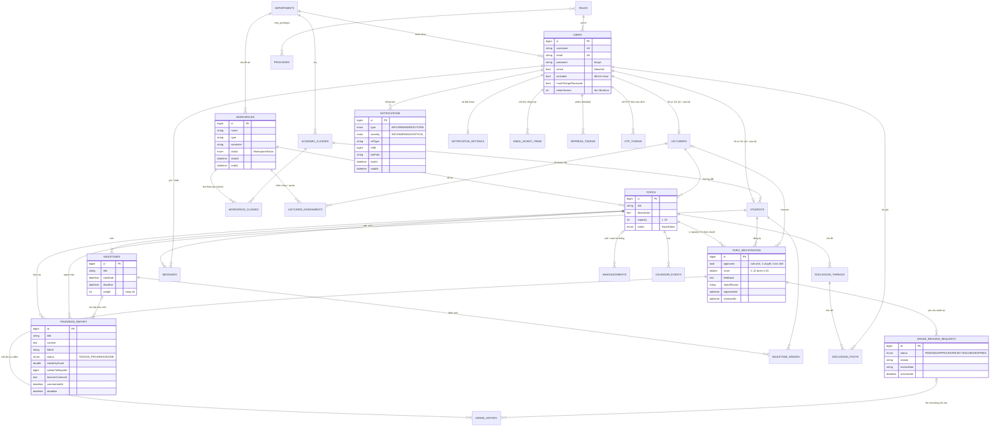

Bảng độc lập (không khóa ngoại): `audit_logs` (ghi tên người thực hiện, IP, trình duyệt), `login_throttle` (khóa = SHA-256 của username|IP), `stored_files` (chủ file, `refType/refId` khi đã gắn báo cáo), `data_migrations`, `flyway_schema_history`.

Lịch sử migration: V1 baseline · V2 vai trò/quyền mặc định · V3 sửa dữ liệu GĐ2 · V4 chuẩn hóa enum trạng thái · V5 index truy vấn · V6 refresh token · V7 IP/trình duyệt trong nhật ký · V8 thời điểm nhận xét tiến độ · V9 trọng số + điểm theo mốc · V10 cài đặt email + hàng chờ thư tổng hợp.

## 2.12 Toàn bộ máy trạng thái

### Đợt đồ án — `WorkspaceStatus`
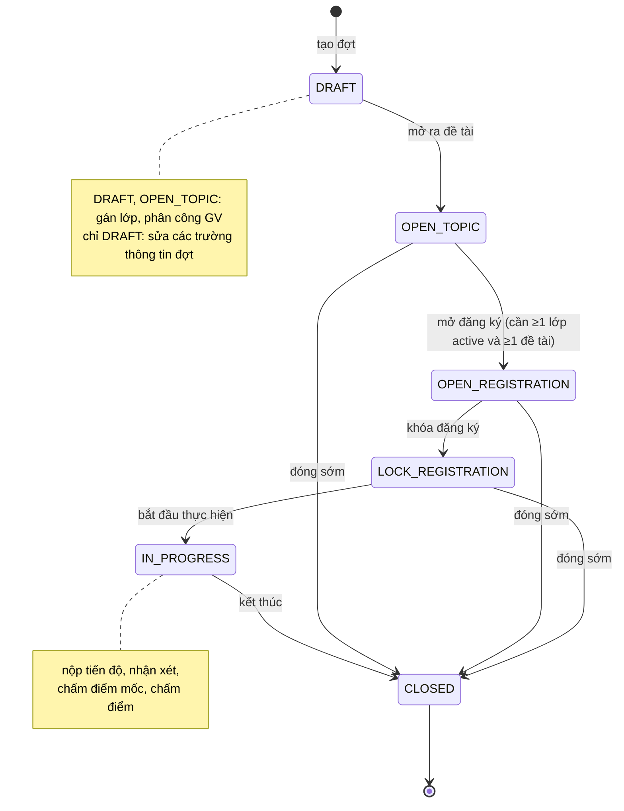

### Đề tài — `TopicStatus`
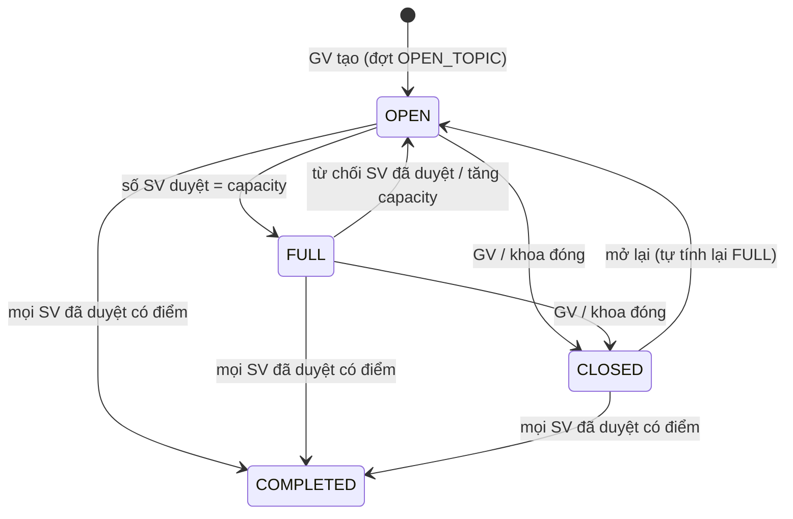

### Đăng ký — `TopicRegistration.approved`
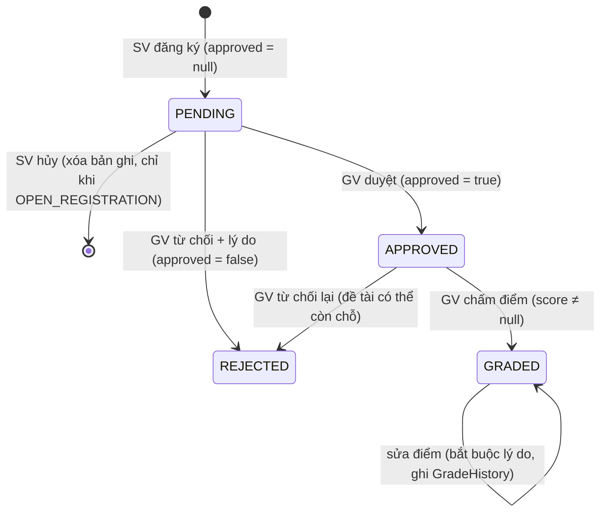

### Báo cáo tiến độ — `ProgressStatus` (Kanban)
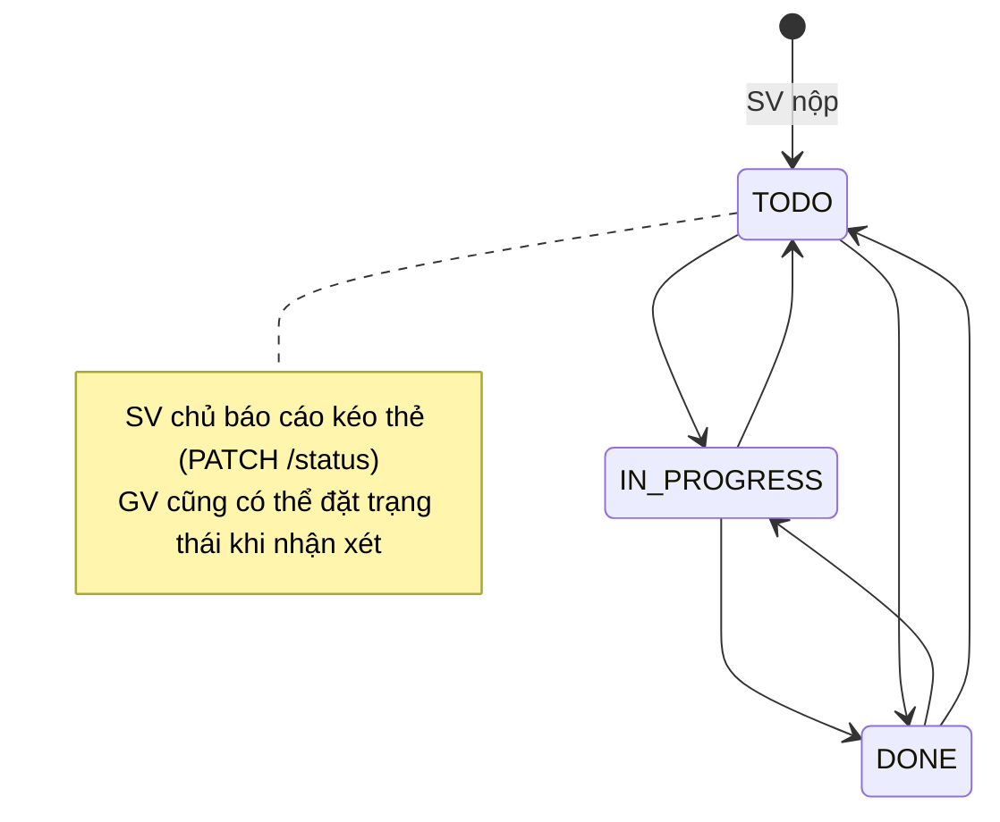

### Trạng thái chấm điểm — `GradeState` (tính động)
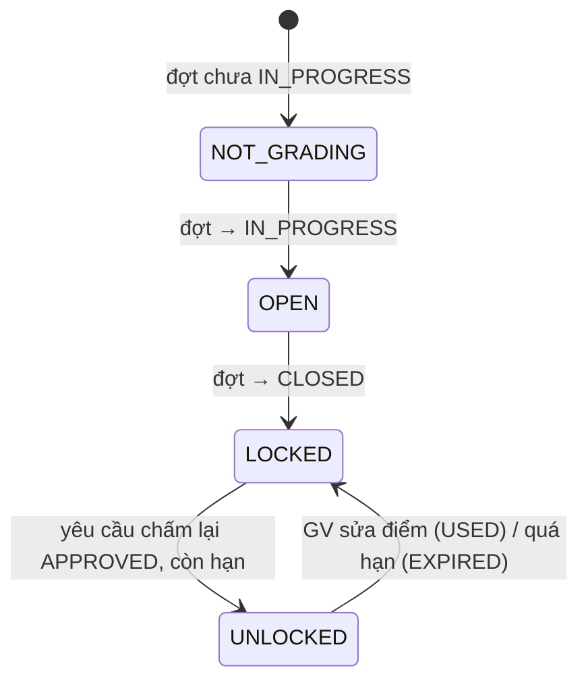

### Yêu cầu chấm lại — `GradeRevisionStatus`
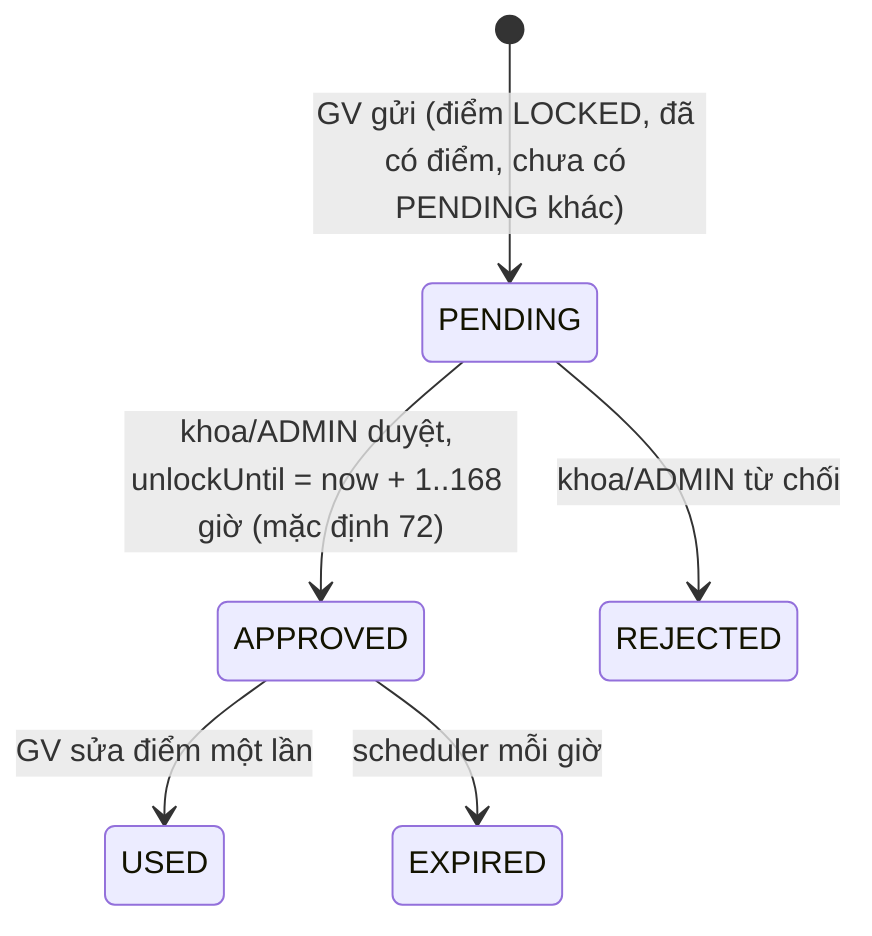

### Mã OTP — `OtpToken`
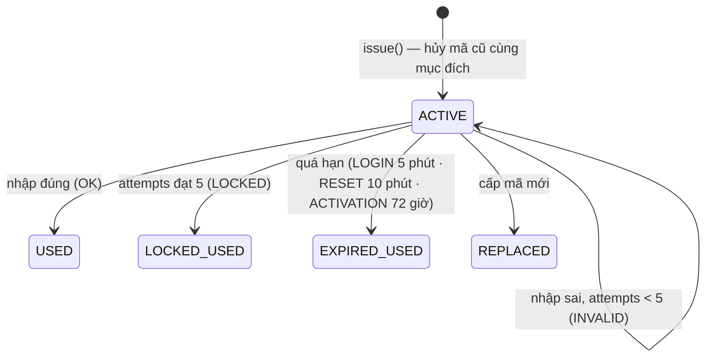

### Refresh token — `RefreshToken`
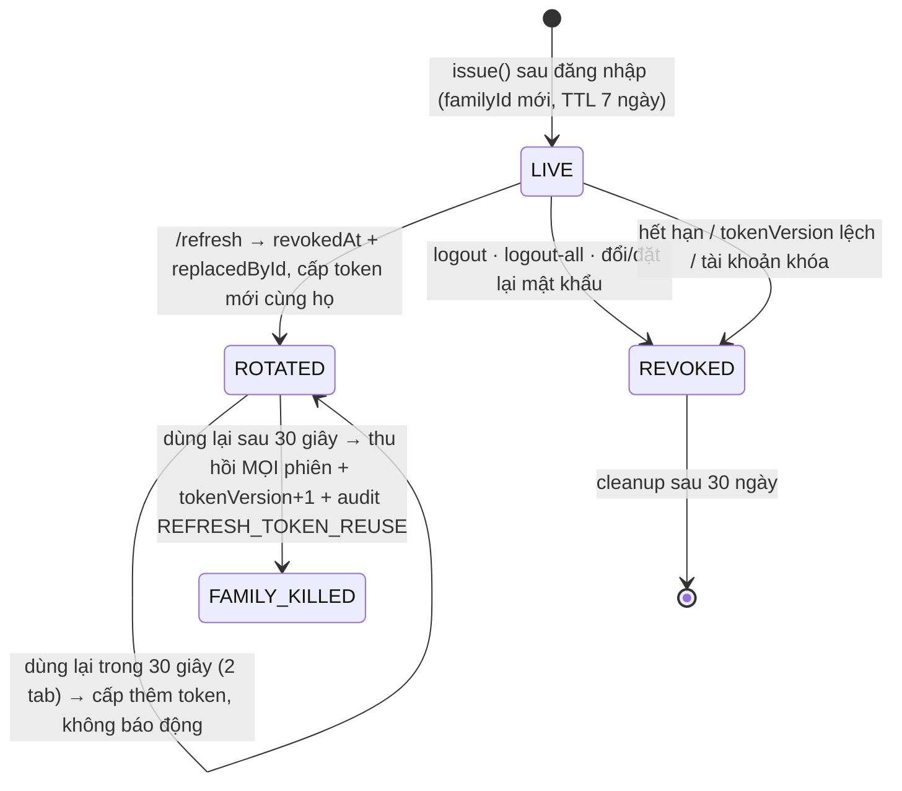

### Tài khoản — `User`
```mermaid
stateDiagram-v2
  [*] --> CHUA_KICH_HOAT: Admin tạo không mật khẩu / nhập Excel / bootstrap (activated=false)
  [*] --> MAT_KHAU_TAM: Admin tạo có mật khẩu tạm (mustChangePassword=true)
  CHUA_KICH_HOAT --> HOAT_DONG: kích hoạt bằng mã email
  MAT_KHAU_TAM --> HOAT_DONG: đổi mật khẩu ở lần đăng nhập đầu
  HOAT_DONG --> BI_KHOA: Admin khóa (active=false, tokenVersion+1)
  BI_KHOA --> HOAT_DONG: Admin mở
  HOAT_DONG --> HOAT_DONG: đổi vai trò / đổi mật khẩu / logout-all (tokenVersion+1)
```
