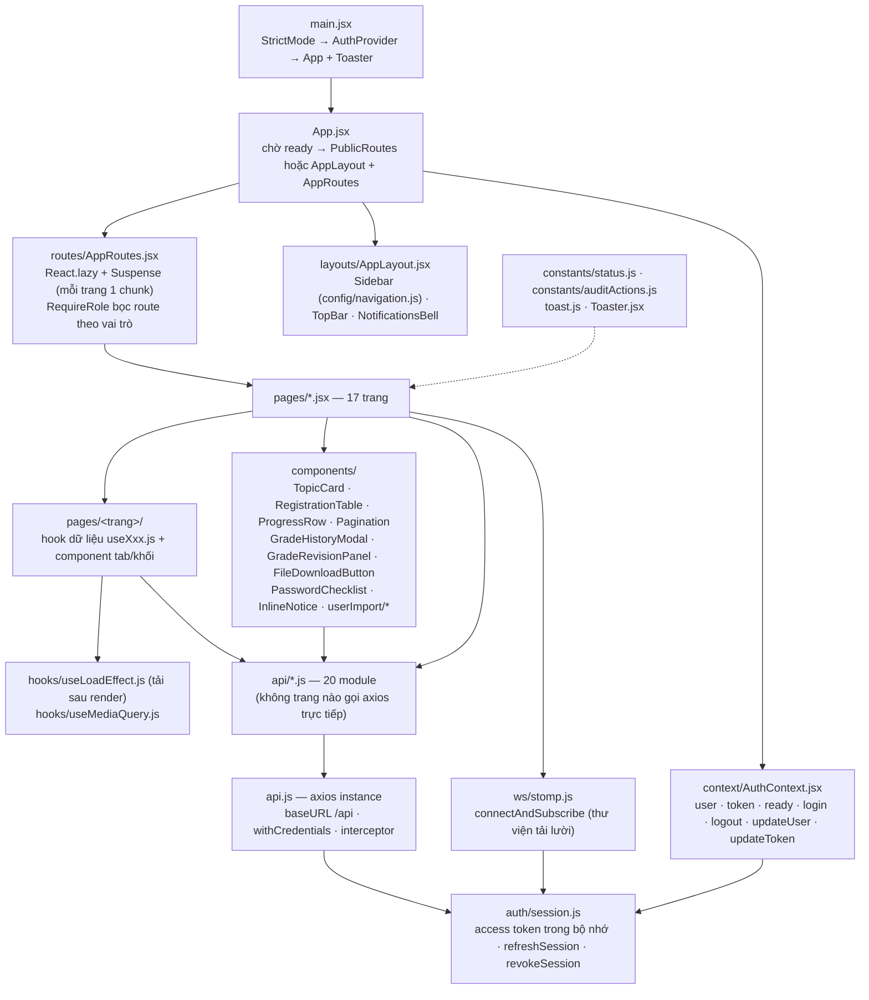
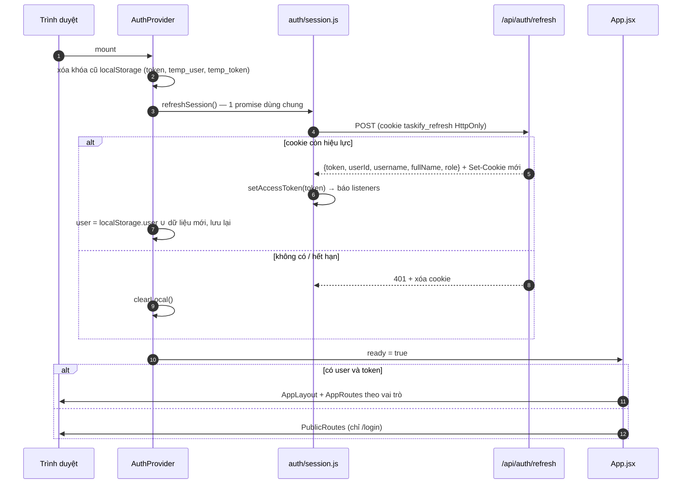
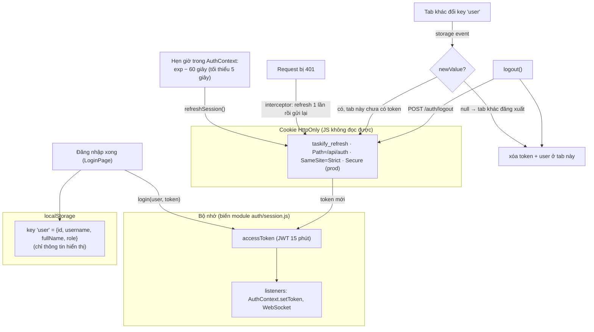
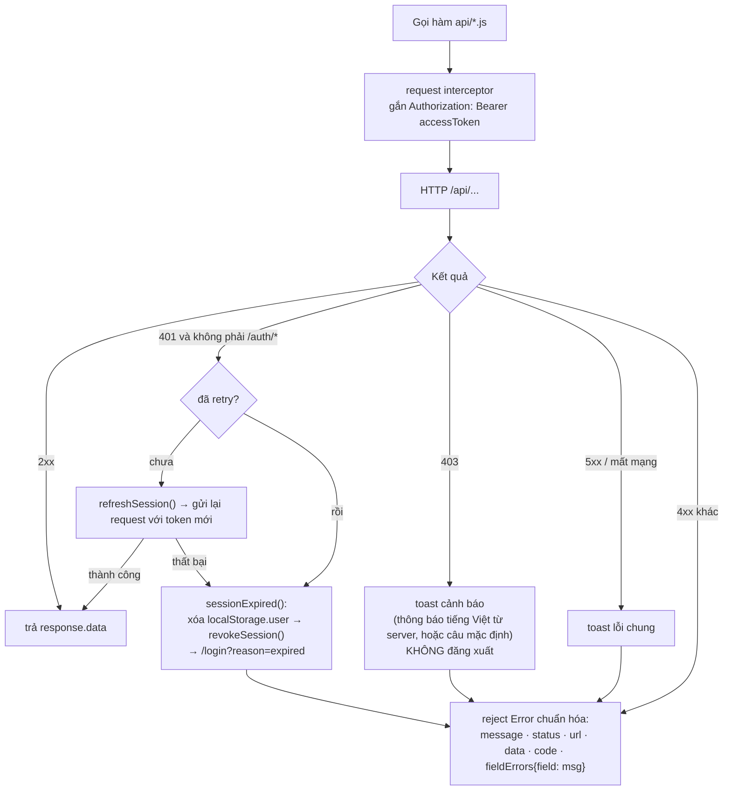
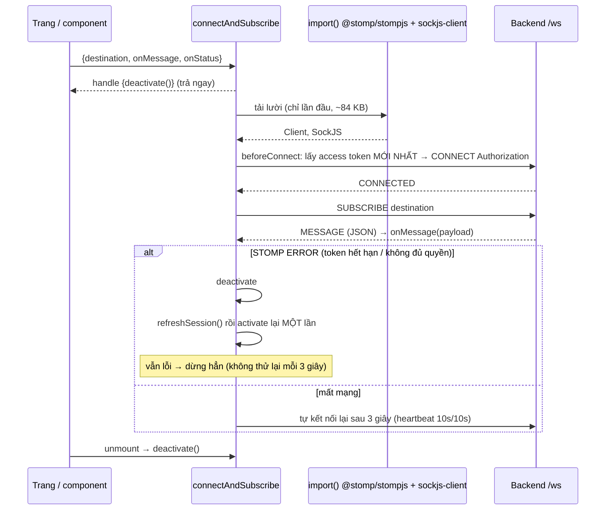
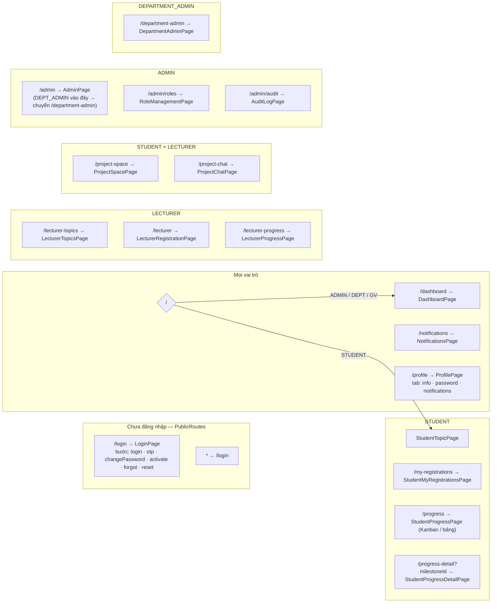
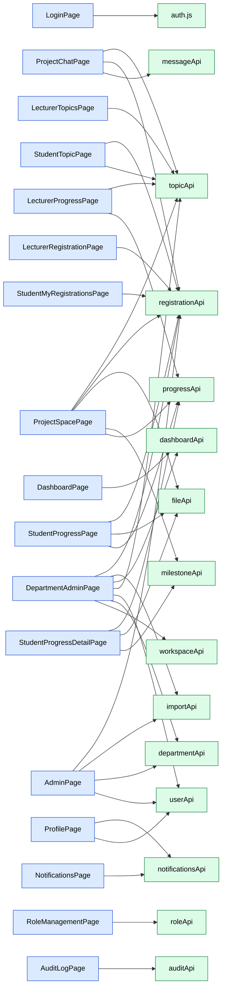
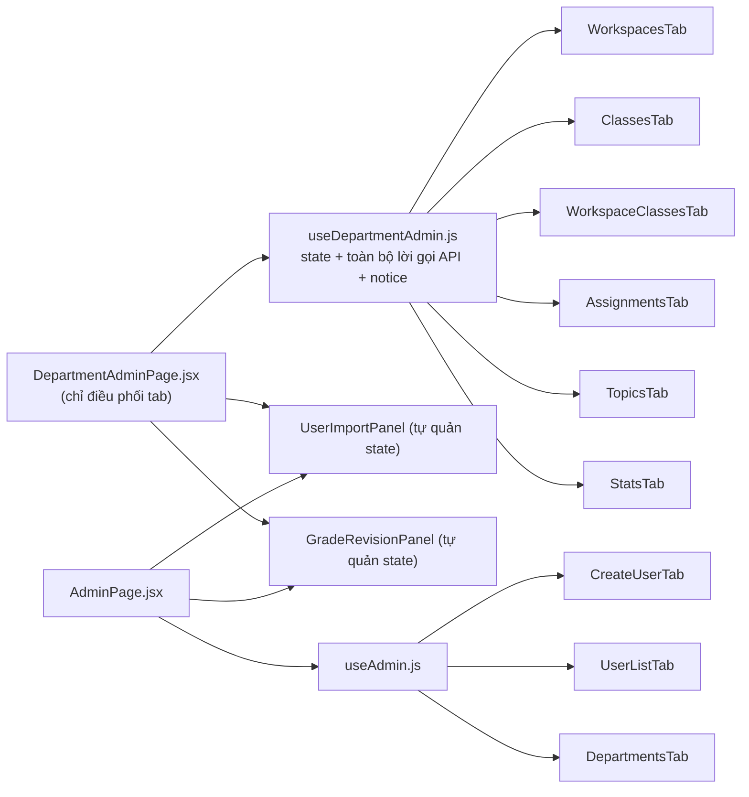

# 03 — Kiến trúc Frontend (React 19 · Vite · Tailwind)

[← Mục lục](README.md)

Thư mục gốc: `frontend/src`.

## 3.1 Cấu trúc thư mục và trách nhiệm

## 3.2 Khởi động ứng dụng và khôi phục phiên

## 3.3 Quản lý access token trong suốt phiên

## 3.4 Interceptor axios (`src/api.js`)

## 3.5 WebSocket client (`src/ws/stomp.js`)

Nơi dùng realtime:

| Kênh | Trang / component | Phản ứng |
|---|---|---|
| `/user/queue/notifications` | `NotificationsBell`, `NotificationsPage` | chèn thông báo mới, tăng số chưa đọc |
| `/user/queue/messages` | `ProjectChatPage` | thêm tin `MESSAGE_CREATED` vào hội thoại đang mở |
| `/topic/progress/{topicId}` | `StudentProgressPage`, `LecturerProgressPage`, `ProjectSpacePage` | tải lại danh sách báo cáo |
| `/topic/registration/{topicId}` | `LecturerRegistrationPage` | tải lại danh sách đăng ký |

## 3.6 Định tuyến theo vai trò

`RequireRole`: khi `ready=false` không quyết định gì (tránh đá ra khi đang khôi phục phiên); sai vai trò → `Navigate /login`. Backend vẫn kiểm tra lại mọi quyền — route guard chỉ để điều hướng.

Menu (`config/navigation.js`) dựng từ dữ liệu: mục **Tổng quan**, nhóm theo vai trò (`ROLE_SECTIONS`), **Hồ sơ của tôi**; tiêu đề cổng theo vai trò (`PORTAL_TITLES`).

## 3.7 Bản đồ trang → component → API

### Chi tiết từng trang

| Trang | Thành phần con | Gọi API | Realtime |
|---|---|---|---|
| `LoginPage` | `login/LoginStep`, `OtpStep`, `ChangePasswordStep`, `ActivateStep`, `ForgotStep`, `ResetStep`, `PasswordChecklist` | `auth.login`, `verifyOtp`, `resendOtp`, `changeInitialPassword`, `activate`, `forgotPassword`, `resetPassword` | — |
| `DashboardPage` | `dashboard/LecturerSection`, `StudentSection`, `OverviewSection`, `charts` | `getLecturerStats` / `getStudentStats` / `getOverview` + `exportOverview` (ADMIN, DEPT) | — |
| `StudentTopicPage` | `TopicCard`, `Pagination` | `topicApi.getAllTopics(studentId…)`, `registrationApi.registerTopic` | — |
| `StudentMyRegistrationsPage` | thẻ theo trạng thái Chờ / Đã duyệt / Bị từ chối | `registrationApi.getMine`, `cancel` | — |
| `StudentProgressPage` | `studentProgress/KanbanColumn`, `KanbanCard`, `ProgressForm`, `ProgressTable`, `kanbanConfig` | `getMine`, `progressApi.listByStudent`, `create`, `updateStatus`, `fileApi.upload` | `/topic/progress/{id}` |
| `StudentProgressDetailPage` | form nộp theo mốc, đồng hồ hạn | `milestoneApi.get`, `fileApi.upload`, `progressApi.create(milestoneId)` | — |
| `LecturerTopicsPage` | `lecturerTopics/TopicTable`, `TopicFormModal`, `topicForm` | `getAllTopics(lecturerId)`, `workspacesOpenForTopics`, `create`, `update`, `remove`, `open`, `close` | — |
| `LecturerRegistrationPage` | `RegistrationTable`, `lecturerRegistration/RegistrationReviewModal`, `GradeHistoryModal` | `getByTopic`, `approve`, `reject`, `grade`, `requestRevision`, `gradeHistory`, `exportExcel` | `/topic/registration/{id}` |
| `LecturerProgressPage` | `ProgressRow`, `FileDownloadButton` | `getAllTopics`, `listByTopic`, `comment` | `/topic/progress/{id}` |
| `ProjectSpacePage` | `projectSpace/MilestonePanel`, `MilestoneForm`, `MilestoneGradeGrid`, `StudentMilestoneList`, `ProgressSubmitPanel`, `ProgressHistoryPanel` | `milestoneApi.board/create/update/delete/grade`, `progressApi.*`, `fileApi.upload` | `/topic/progress/{id}` |
| `ProjectChatPage` | `projectChat/ChatPeopleSidebar`, `ChatConversation` | `getMine` / `getByTopic` (danh sách người nhận), `messageApi.conversation` (phân trang), `send` | `/user/queue/messages` |
| `NotificationsPage` | danh sách + lọc | `listMine`, `markRead`, `markAllRead` | `/user/queue/notifications` |
| `ProfilePage` | `profile/NotificationSettingsTab` | `userApi.get`, `updateProfile`, `changePassword`, `getSettings`, `saveSettings` | — |
| `AdminPage` | `admin/CreateUserTab`, `UserListTab`, `DepartmentsTab`, `userImport/UserImportPanel`, `GradeRevisionPanel`, hook `useAdmin` | `userApi.*`, `departmentApi.list/create/listClasses`, `importApi.*`, `registrationApi.listRevisions/approveRevision/rejectRevision`, `gradeHistory` | — |
| `RoleManagementPage` | ma trận vai trò × quyền | `roleApi.getAllRoles/getAllPrivileges/createRole/updateRole/deleteRole` | — |
| `AuditLogPage` | `auditLog/AuditFilters`, `AuditTable` | `auditApi.search`, `options`, `exportCsv` | — |
| `DepartmentAdminPage` | `departmentAdmin/WorkspacesTab`, `ClassesTab`, `WorkspaceClassesTab`, `AssignmentsTab`, `TopicsTab`, `StatsTab`, `UserImportPanel`, `GradeRevisionPanel`, hook `useDepartmentAdmin` | `workspaceApi.*`, `departmentApi.*`, `userApi.getByDepartment`, `topicApi.getAllTopics/open/close`, `dashboardApi.getDepartmentAdminStats` | — |

## 3.8 Tách trang lớn: trang → hook dữ liệu → tab

Quy tắc chung (GĐ3 — P3-11): tệp lớn nhất ≤ 353 dòng; `useLoadEffect` tải dữ liệu sau render (không `setState` đồng bộ trong effect, thỏa React Compiler); `npm run lint` chặn mọi cảnh báo.

## 3.9 API backend chưa có giao diện

Những endpoint dưới đây đã chạy ở backend (một số đã có hàm trong `src/api/*`) nhưng **chưa trang nào gọi** — cần lưu ý khi làm tài liệu hoặc lên kế hoạch giai đoạn sau.

| Endpoint | Hàm frontend sẵn có | Ghi chú |
|---|---|---|
| `GET/POST /api/discuss/threads`, `/threads/{id}/posts` | `discussApi.threads/createThread/posts/addPost` | thảo luận nhóm theo chủ đề |
| `GET/POST /api/announcements` | `announcementApi` | thông báo chung theo đề tài / toàn hệ thống |
| `GET/POST/DELETE /api/calendar` | `calendarApi` | lịch đề tài (đã gộp mốc) |
| `GET /api/messages/inbox` | `messageApi.inbox` | hộp thư gom nhóm theo hội thoại |
| `POST /api/notifications/create` | — | gửi thông báo thủ công |
| `POST /api/auth/logout-all` | — | đăng xuất mọi thiết bị |
| `GET /api/dashboard/admin` | `dashboardApi.getAdminStats` | số liệu nhanh toàn hệ thống |
| `GET /api/audit/recent` | — | nhật ký gần đây |
| `POST /api/roles/privileges` | `roleApi.createPrivilege` | tạo quyền mới |
| `PUT /api/departments/{id}`, `/status` | — | sửa / bật-tắt khoa |
| `PUT /api/classes/{id}` | — | sửa lớp |
| `GET/PUT /api/workspaces/{id}`, `/open`, `/close` | — | xem / sửa đợt (UI dùng `/transition`) |
