# 04 — Luồng A: Xác thực & phiên đăng nhập

[← Mục lục](README.md)

Thành phần chính: `LoginPage` (+ 6 bước trong `pages/login/`) · `AuthContext` · `auth/session.js` · `AuthController` · `AuthService` · `OtpService` · `LoginThrottleService` · `RateLimiter` · `RefreshTokenService` · `SessionCookies` · `RefreshCookie` · `JwtTokenProvider` · `TokenAuthenticator`.

## Tổng quan các bước đăng nhập (máy trạng thái phía giao diện)

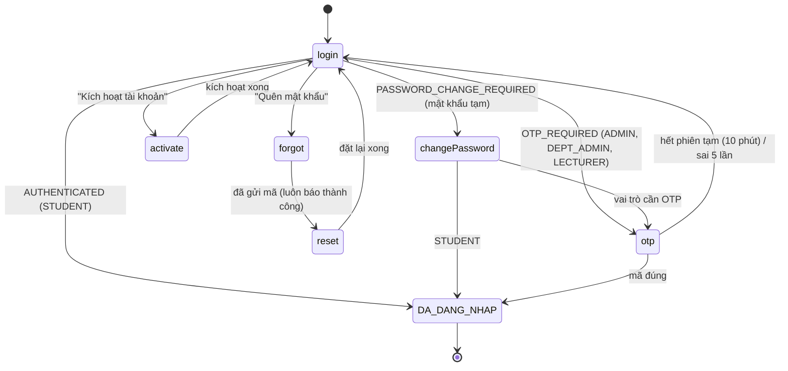

Ba loại JWT (`JwtTokenProvider.Scope`), cùng khóa HS256, claim `sub`, `iss=taskify`, `userId`, `scope`, `tv`:

| Scope | Thời hạn | Dùng được cho | Cấp ở |
|---|---|---|---|
| `ACCESS` | 15 phút (`JWT_EXPIRATION`) | mọi API nghiệp vụ, CONNECT WebSocket | `issueSession`, `refresh`, `changePassword` |
| `OTP_PENDING` | 10 phút | `/auth/otp/verify`, `/auth/otp/resend` | sau mật khẩu đúng, vai trò cần OTP |
| `PWD_CHANGE` | 10 phút | `/auth/password/initial` | sau mật khẩu đúng, `mustChangePassword=true` |

---

## A1. Chính sách mật khẩu

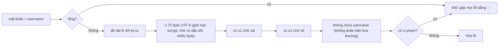
Áp dụng ở: đổi mật khẩu lần đầu, kích hoạt, đặt lại mật khẩu, đổi mật khẩu trong hồ sơ, Admin đặt mật khẩu tạm. Frontend hiển thị trực quan bằng `PasswordChecklist`. Riêng "không trùng mật khẩu hiện tại" kiểm tra ở nơi đổi mật khẩu (cần so băm).

## A2. Đăng nhập bằng mật khẩu

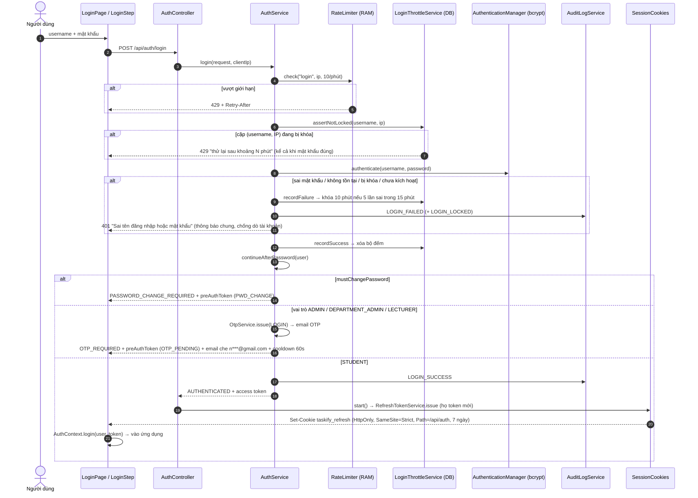

Bộ đếm khóa đăng nhập lưu ở bảng `login_throttle` với khóa SHA-256 của `username|IP`: khóa theo **cặp** để kẻ xấu ở IP khác không khóa được tài khoản người khác; lưu DB nên còn nguyên sau khi khởi động lại.

## A3. Xác thực 2 bước bằng OTP

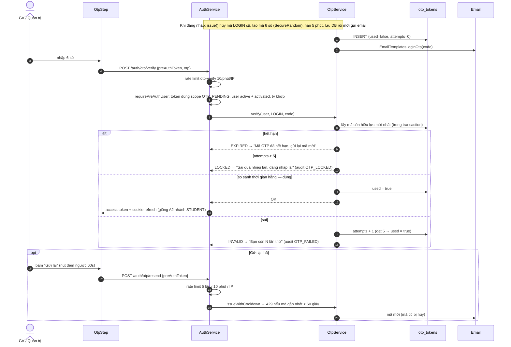

## A4. Đổi mật khẩu bắt buộc lần đầu (mật khẩu tạm)

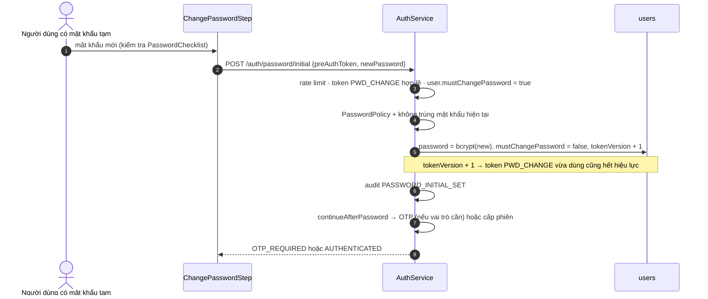

## A5. Kích hoạt tài khoản

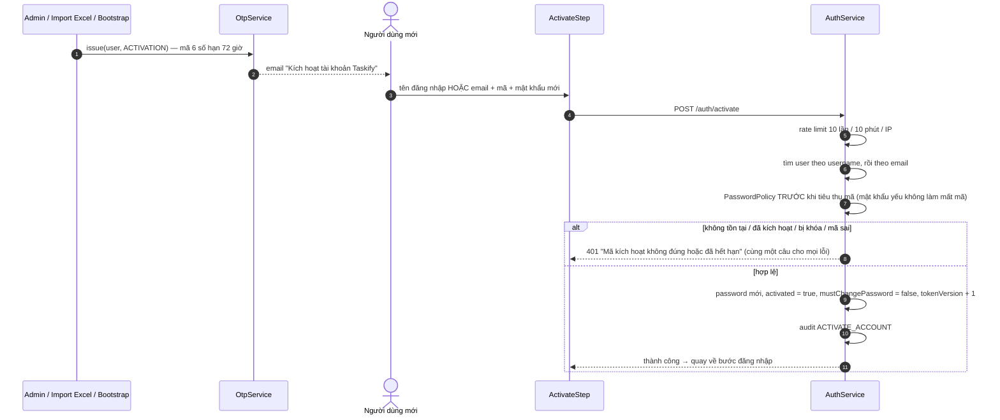

## A6. Quên mật khẩu → đặt lại

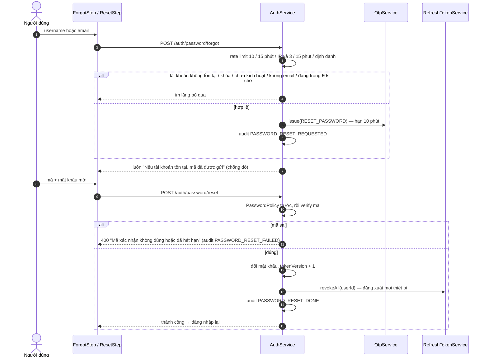

## A7. Làm mới phiên (refresh token xoay vòng)

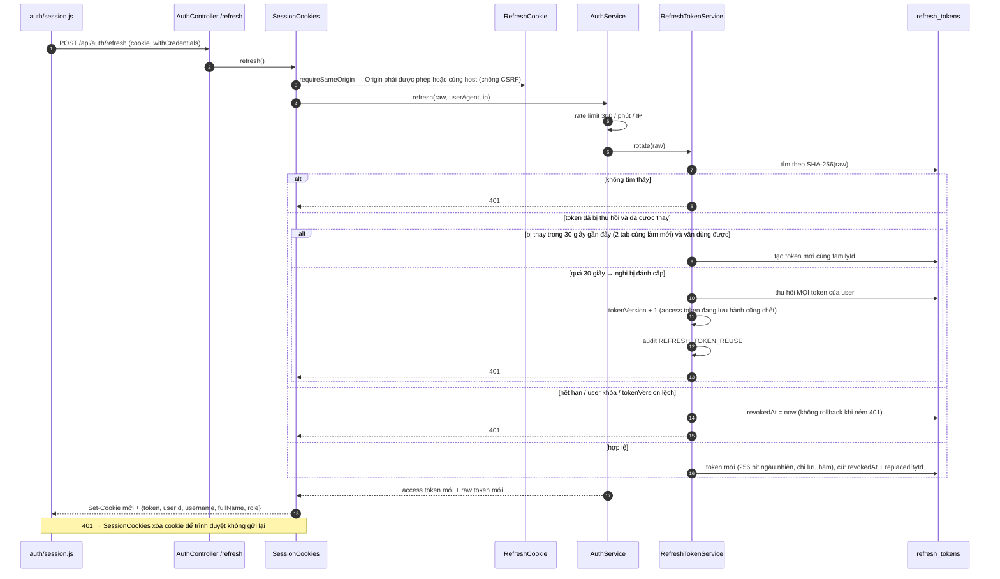

## A8. Khôi phục phiên, làm mới chủ động, đồng bộ nhiều tab

```mermaid
flowchart TB
  subgraph RELOAD["Tải lại trang"]
    R1["AuthProvider mount"] --> R2["refreshSession()"]
    R2 -->|"OK"| R3["user + token → ready"]
    R2 -->|"401"| R4["clearLocal → ready → /login"]
  end
  subgraph PRO["Làm mới chủ động"]
    P1["token đổi"] --> P2["đọc exp trong JWT"]
    P2 --> P3["setTimeout(exp − 60s, tối thiểu 5s)"]
    P3 --> P4["refreshSession()"]
    P4 -->|"lỗi"| P5["clearLocal → /login?reason=expired"]
  end
  subgraph REACT["Phản ứng khi gặp 401"]
    Q1["request bất kỳ 401"] --> Q2["interceptor: refreshSession() 1 lần<br/>(nhiều request chờ chung 1 promise)"]
    Q2 --> Q3["gửi lại request"]
    Q2 -->|"lỗi"| Q4["sessionExpired → logout server + /login"]
  end
  subgraph TABS["Nhiều tab"]
    T1["tab A đăng xuất → xóa localStorage.user"] --> T2["tab B nhận storage event → xóa token, user"]
    T3["tab A đăng nhập → ghi user"] --> T4["tab B chưa có token → refreshSession() bằng cookie chung"]
  end
```

## A9 · A10. Đăng xuất / đăng xuất mọi thiết bị

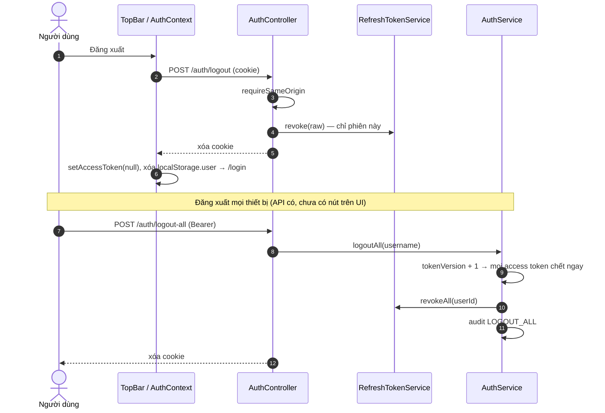

## A11. Xác thực từng request & thu hồi tức thì bằng `tokenVersion`

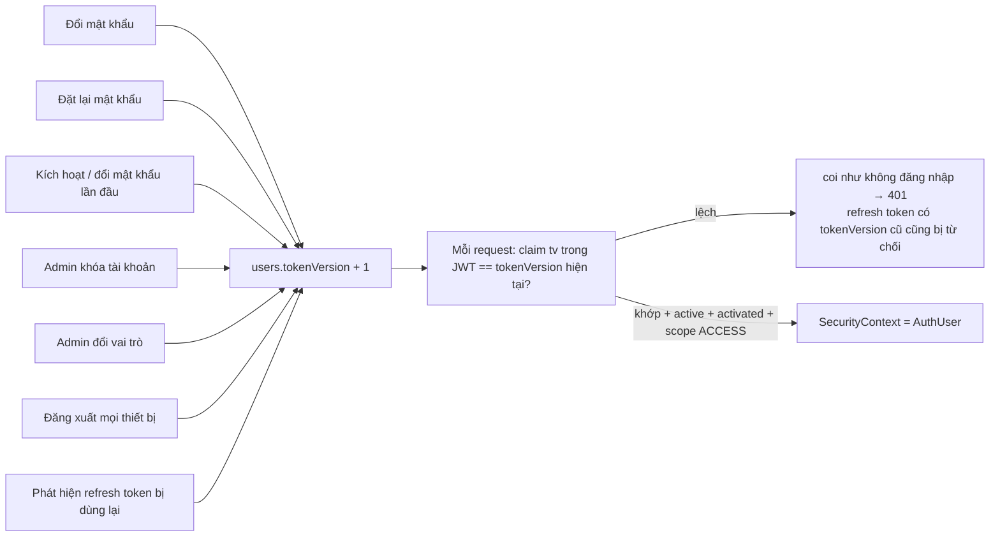
Cùng một `TokenAuthenticator` dùng cho filter HTTP và `CONNECT` WebSocket nên hai nơi không bao giờ lệch nhau.

## A12. Tạo ADMIN đầu tiên cho bản cài mới

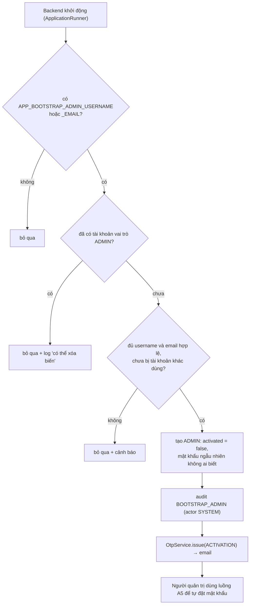
Môi trường dev dùng `DataSeeder` thay thế: tạo khoa CNTT, lớp CNTT-K15, đợt mẫu và các tài khoản `admin`, `deptadmin`, `lecturer`, `student`, `student2` (mật khẩu `123456`; email dạng `ten+admin@gmail.com` để nhận OTP thật).
