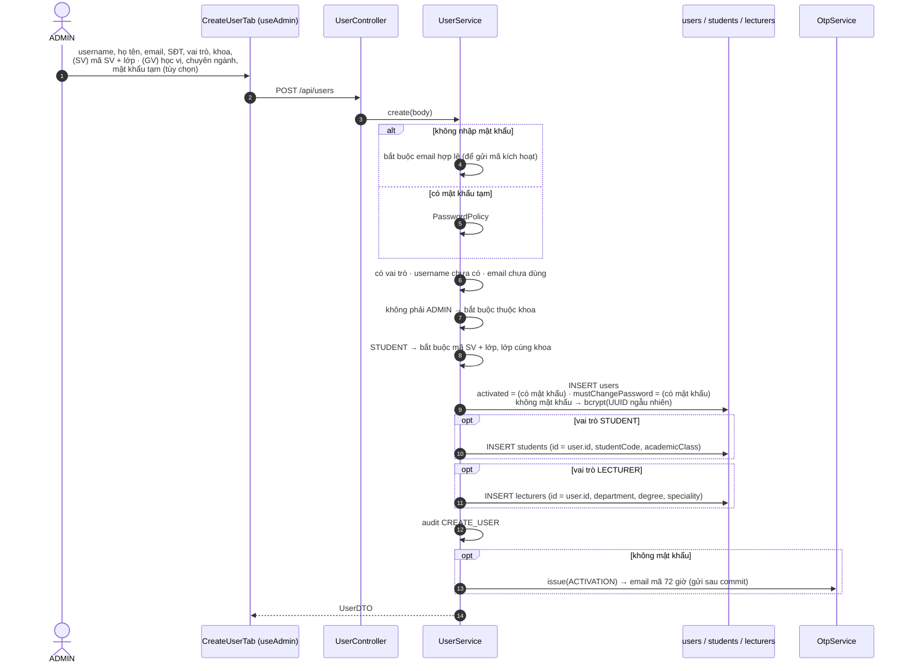
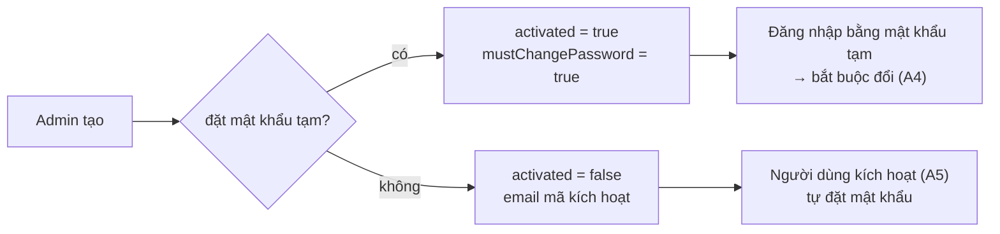
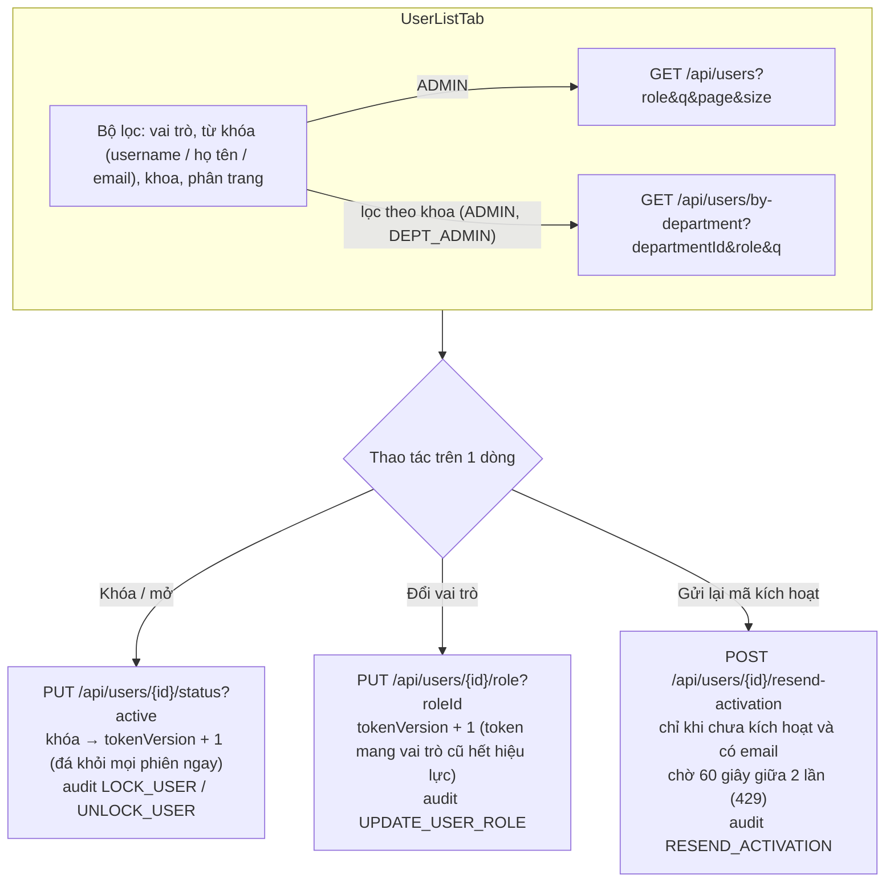
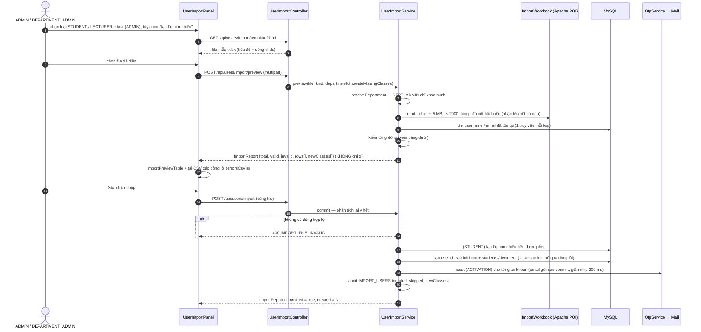
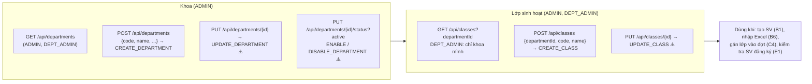
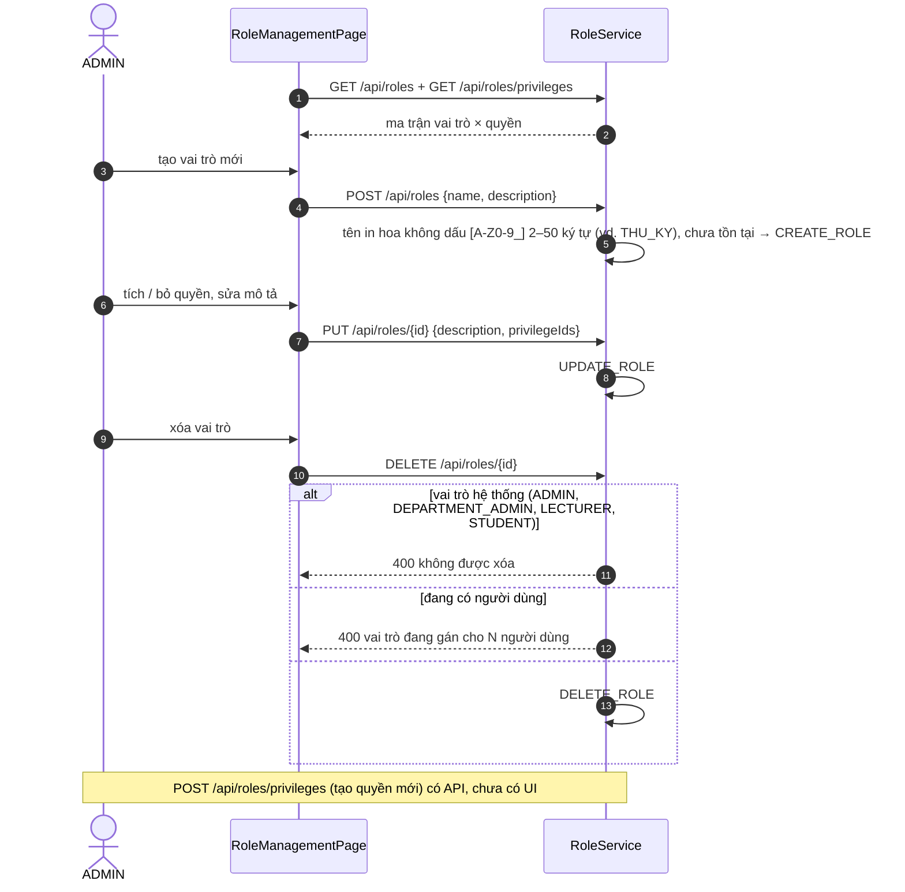
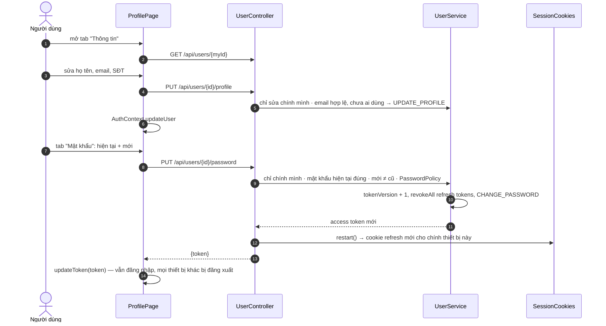
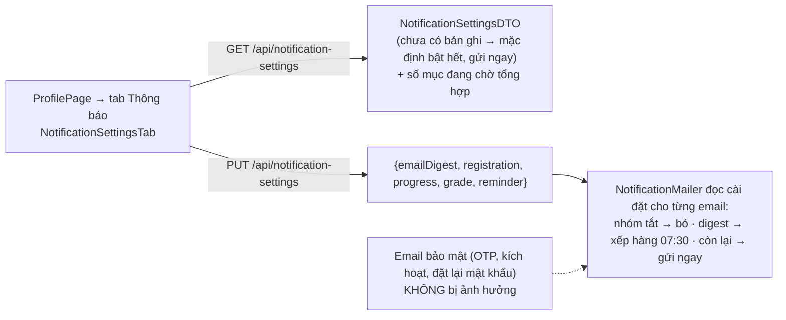

# 05 — Luồng B: Quản trị người dùng & tổ chức

[← Mục lục](README.md)

Thành phần chính: `AdminPage` (`useAdmin`, `CreateUserTab`, `UserListTab`, `DepartmentsTab`) · `UserImportPanel` · `RoleManagementPage` · `ProfilePage` (+ `NotificationSettingsTab`) · `UserService` · `UserImportService` + `ImportWorkbook` + `ImportKind` · `DepartmentService` · `AcademicClassService` · `RoleService` · `NotificationSettingsService`.

## B1. Tạo tài khoản

Hai cách cấp tài khoản và hệ quả ở lần đăng nhập đầu:

## B2 – B5. Danh bạ & thao tác trên tài khoản

Quyền xem hồ sơ (`GET /api/users/{id}`): **đầy đủ** (email, SĐT, vai trò, khoa) cho chính chủ, ADMIN, quản trị khoa cùng khoa; người khác chỉ thấy `id` + họ tên.

## B6. Nhập sinh viên / giảng viên từ Excel

| Cột (SV) | Cột (GV) | Kiểm tra |
|---|---|---|
| MSSV* | Mã giảng viên* | ≤ 50 ký tự, chỉ `[A-Za-z0-9._-]`, chưa có tài khoản, không trùng trong file |
| Họ tên* | Họ tên* | ≤ 100 ký tự |
| Email* | Email* | định dạng hợp lệ, ≤ 100, chưa dùng, không trùng trong file |
| Mã lớp* | Học vị, Chuyên ngành | lớp phải có trong khoa và đang hoạt động (hoặc được phép tạo mới) · học vị ≤ 100, chuyên ngành ≤ 255 |
| Số điện thoại | Số điện thoại | ≤ 20 ký tự |

## B7 · B8. Khoa và lớp

⚠️ = có API, chưa có nút trên giao diện. UI: `DepartmentsTab` (AdminPage), `ClassesTab` (DepartmentAdminPage).

## B9. Vai trò & quyền hạn

## B10. Hồ sơ cá nhân

## B11. Cài đặt email thông báo

