# 06 — Luồng C · D · E: Đợt đồ án, Đề tài, Đăng ký

[← Mục lục](README.md)

Thành phần chính: `DepartmentAdminPage` (`useDepartmentAdmin`, `WorkspacesTab`, `WorkspaceClassesTab`, `AssignmentsTab`, `TopicsTab`) · `LecturerTopicsPage` · `StudentTopicPage` · `StudentMyRegistrationsPage` · `LecturerRegistrationPage` · `WorkspaceService` · `WorkspaceClassService` · `LecturerAssignmentService` · `TopicService` · `TopicRegistrationService`.

---

# C. Đợt đồ án (workspace)

## C1 · C2. Tạo và sửa đợt

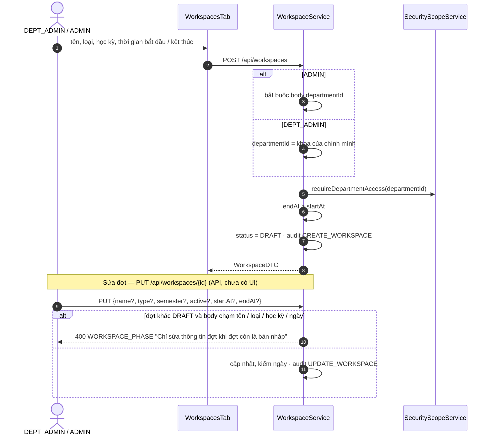

## C3. Chuyển trạng thái đợt

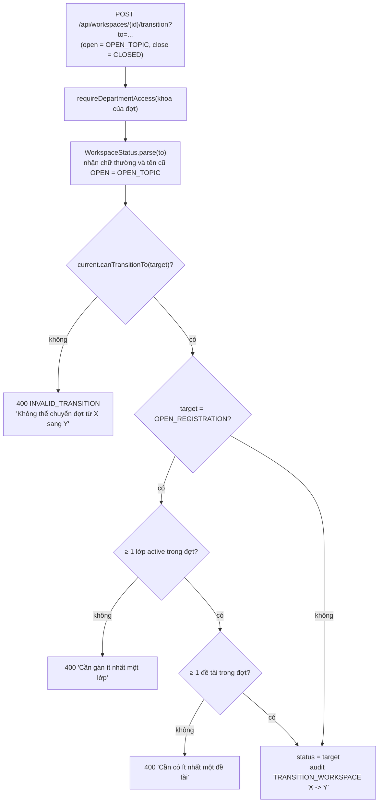

Mỗi trạng thái mở khóa những thao tác gì:

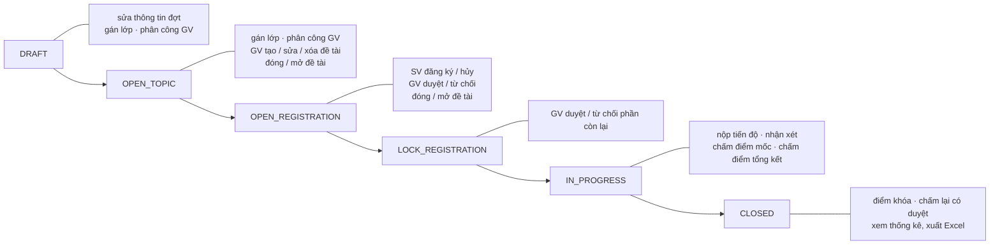

## C4. Gán / gỡ lớp vào đợt

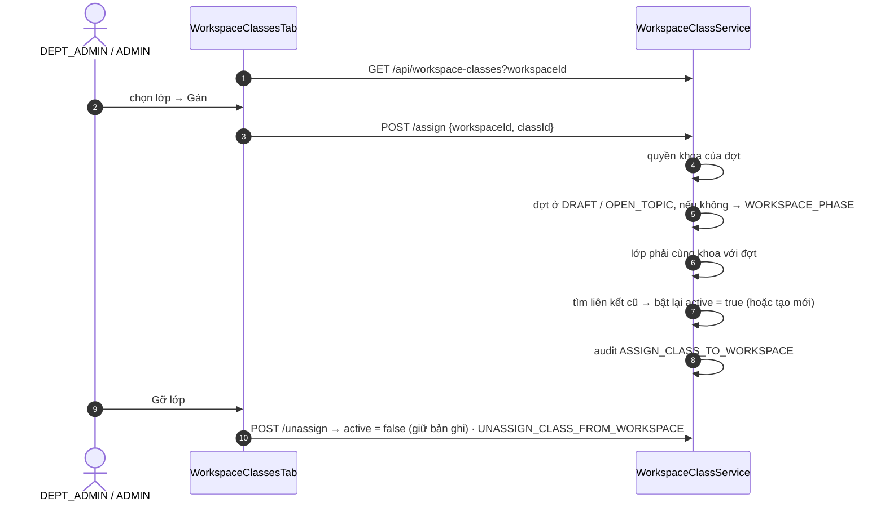
Lớp active của đợt quyết định **sinh viên nào được đăng ký** đề tài trong đợt (E1).

## C5. Phân công giảng viên + quota

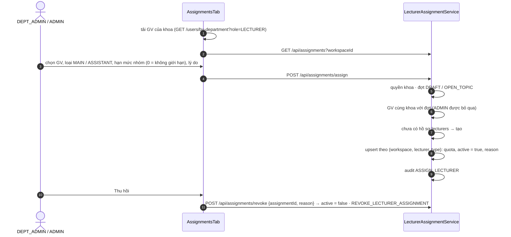
> Ghi chú hiện trạng: `quotaMaxGroups` và phân công được lưu và hiển thị (dashboard đếm "GV chưa được phân công"), nhưng **chưa được kiểm tra** khi giảng viên tạo đề tài hay duyệt đăng ký — GV cùng khoa vẫn tạo được đề tài trong đợt kể cả khi chưa được phân công.

## C6. Khoa duyệt đề tài (đóng / mở)

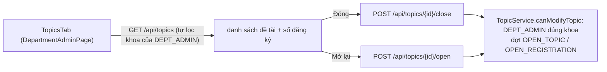

---

# D. Đề tài

## D1 · D2. GV tạo / sửa / xóa đề tài

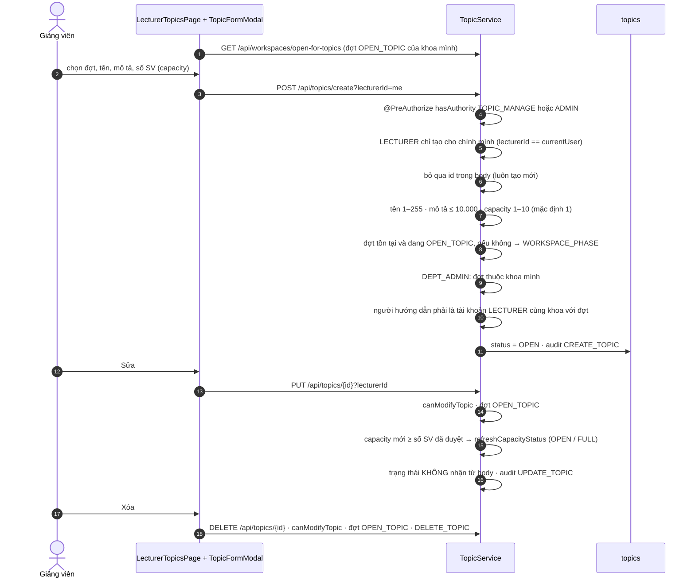

`canModifyTopic(topic, lecturerId)`: ADMIN luôn được · DEPT_ADMIN nếu đề tài thuộc khoa mình · LECTURER nếu `lecturerId` là chính mình **và** là GV hướng dẫn của đề tài.

## D3. Đóng / mở đề tài

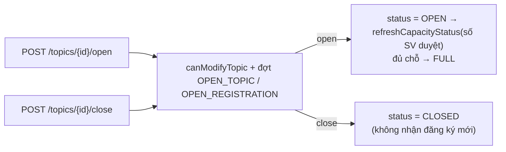

## D4. Danh sách & tìm kiếm đề tài

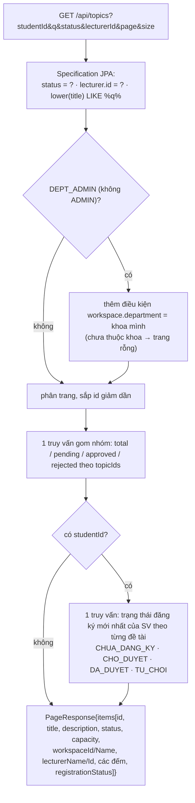
Dùng ở: `StudentTopicPage` (thẻ `TopicCard` + nút Đăng ký), `LecturerTopicsPage` (lọc `lecturerId`), `TopicsTab` của khoa, chọn đề tài ở `LecturerProgressPage` / `ProjectSpacePage` / `ProjectChatPage`.

---

# E. Đăng ký đề tài

## E1. Sinh viên đăng ký — chuỗi kiểm tra

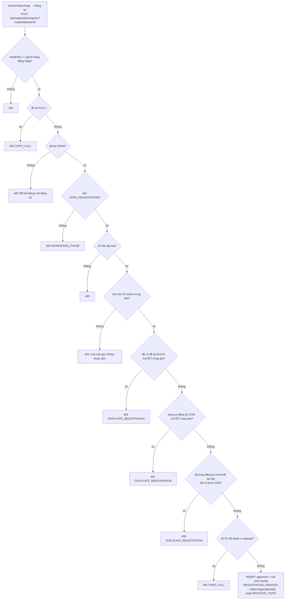

## E2. Sinh viên hủy đăng ký

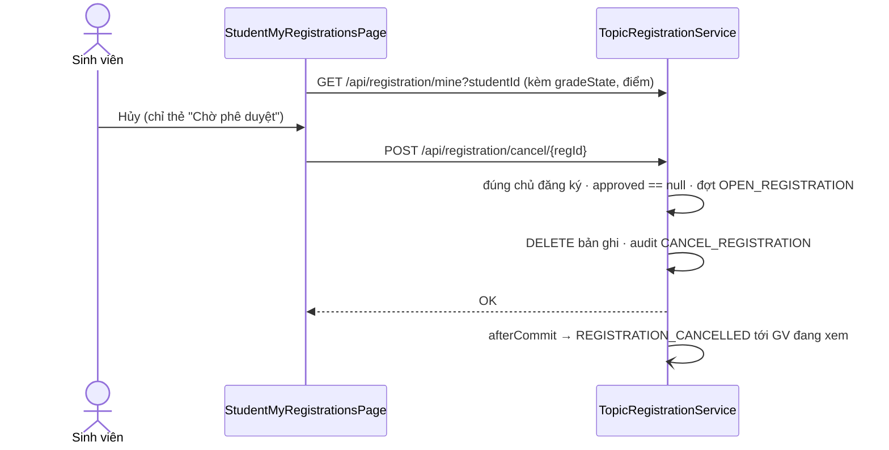

## E3 · E4. Giảng viên duyệt / từ chối

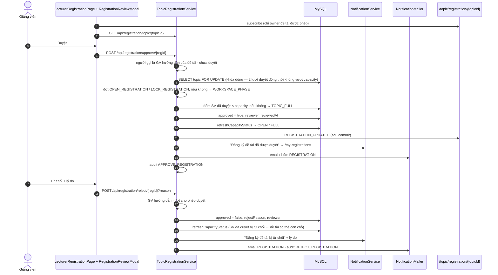

## E5 · E6. Xem đăng ký và cập nhật realtime

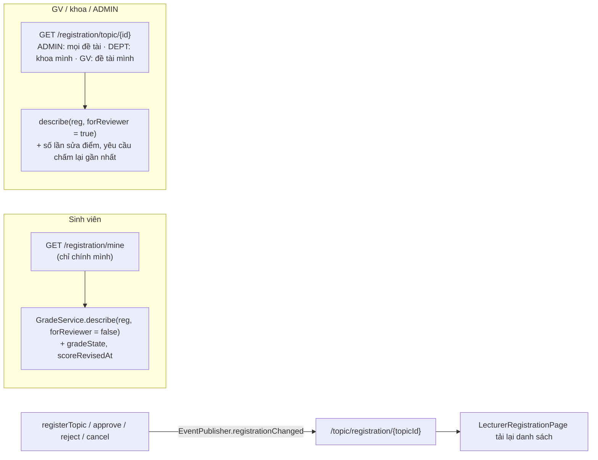
