# 07 — Luồng F · G: Tiến độ, File, Mốc tiến độ

[← Mục lục](README.md)

Thành phần chính: `StudentProgressPage` (Kanban) · `StudentProgressDetailPage` (nộp theo mốc) · `LecturerProgressPage` · `ProjectSpacePage` (`MilestonePanel`, `MilestoneForm`, `MilestoneGradeGrid`, `StudentMilestoneList`, `ProgressSubmitPanel`, `ProgressHistoryPanel`) · `FileDownloadButton` · `FileUploadController` · `FileStorageService` · `FileContentValidator` · `FileDownloadService` · `ProgressService` · `SimilarityService` · `MilestoneService` · `MilestoneGradeService`.

---

# F. Tiến độ & file

## F1. Tải file lên

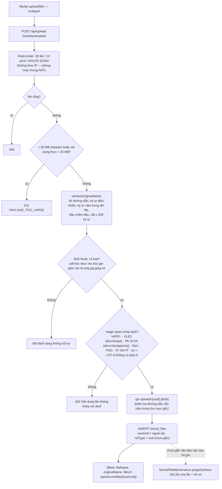

## F2. Tải file xuống có kiểm quyền

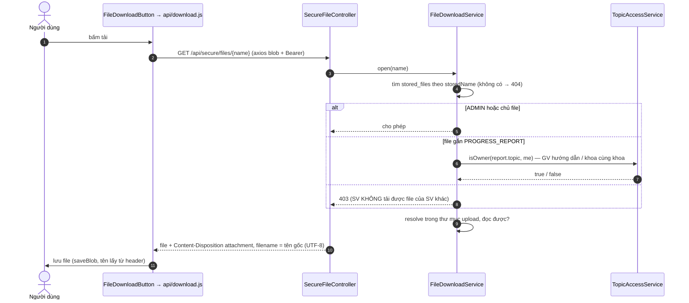

## F3. Kiểm tra trùng lặp nội dung báo cáo

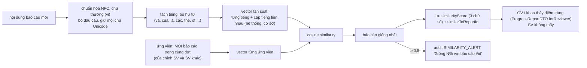

## F4. Sinh viên nộp báo cáo tiến độ

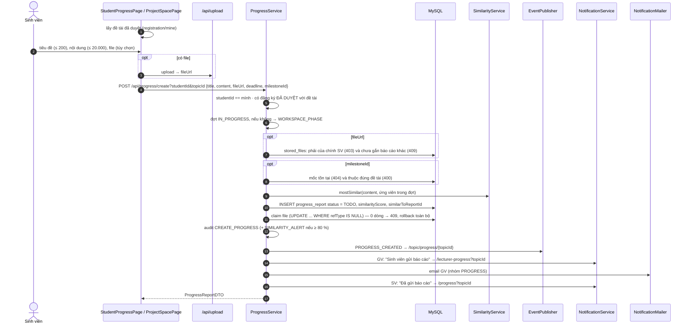

## F5. Kanban — sinh viên đổi trạng thái

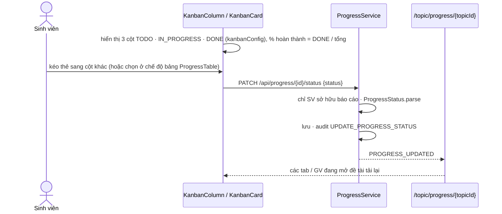
> Ghi chú hiện trạng: đổi trạng thái Kanban **không kiểm tra giai đoạn đợt** (khác với nộp báo cáo và nhận xét, vốn yêu cầu `IN_PROGRESS`).

## F6. Giảng viên nhận xét báo cáo

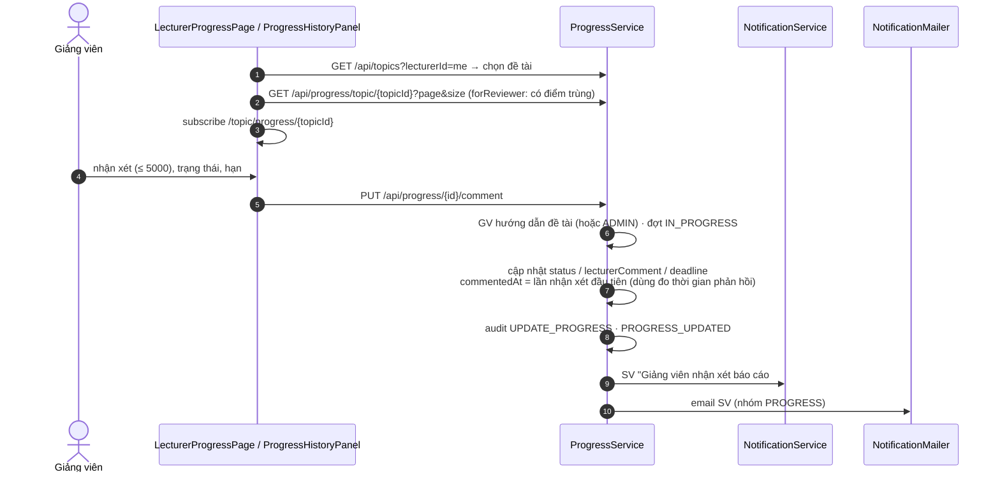

## F7. Ai xem được tiến độ của ai

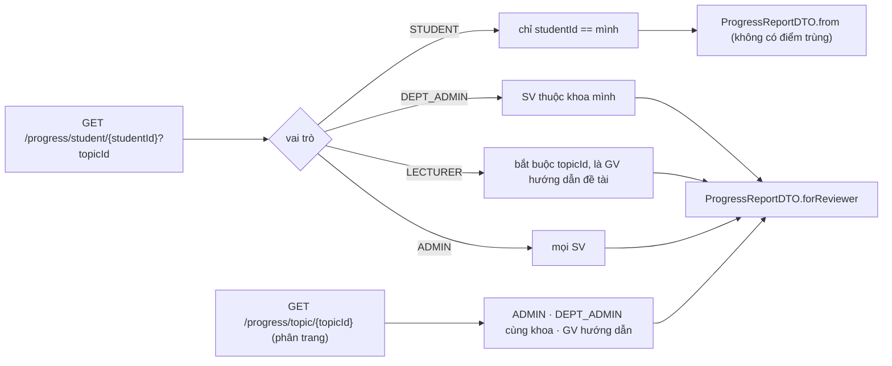

---

# G. Mốc tiến độ (milestone)

## G1. Tạo / sửa / xóa mốc

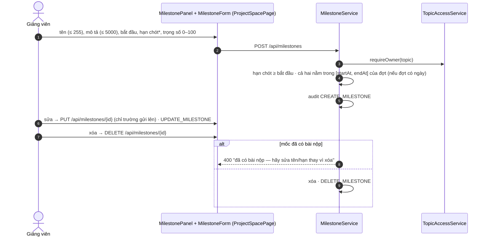
Mốc cũng xuất hiện trong lịch đề tài (`CalendarService.list` gộp sự kiện + mốc) và trong nhắc hạn tự động (K3).

## G2. Sinh viên nộp bài theo mốc

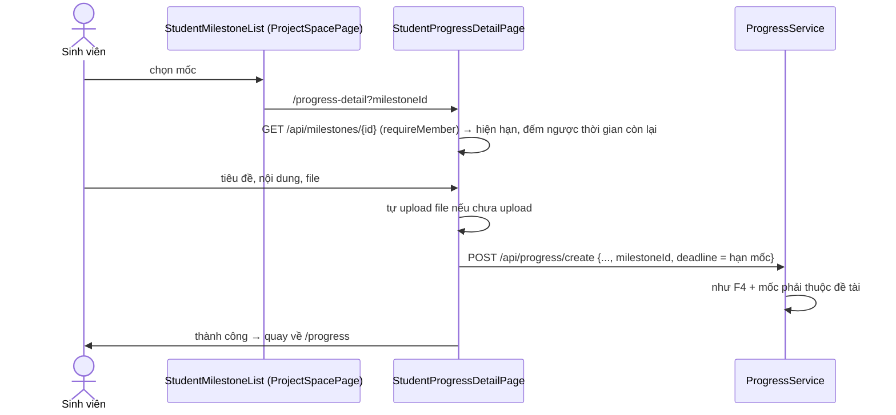

## G3. Bảng điểm mốc (board)

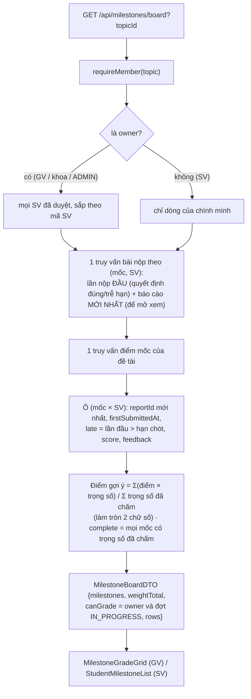
Điểm gợi ý **chỉ để tham khảo** — GV vẫn tự nhập điểm tổng kết (H2).

## G4. Chấm điểm mốc

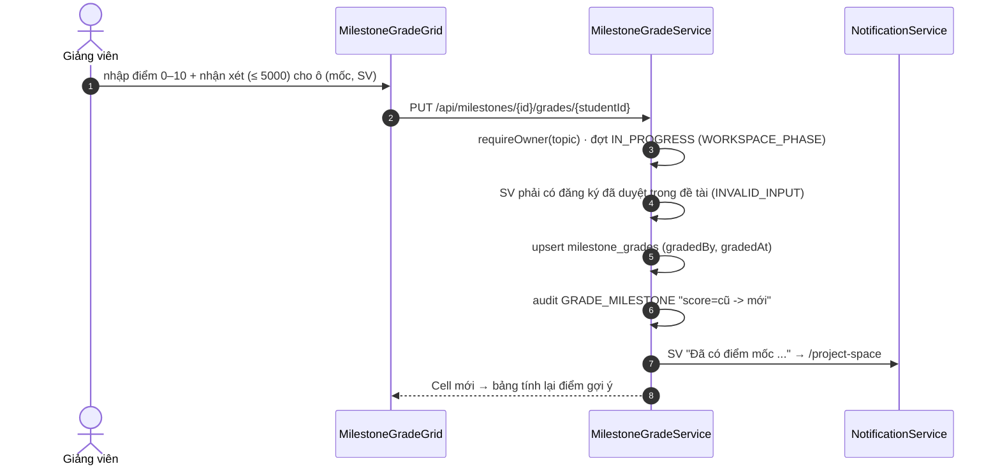
