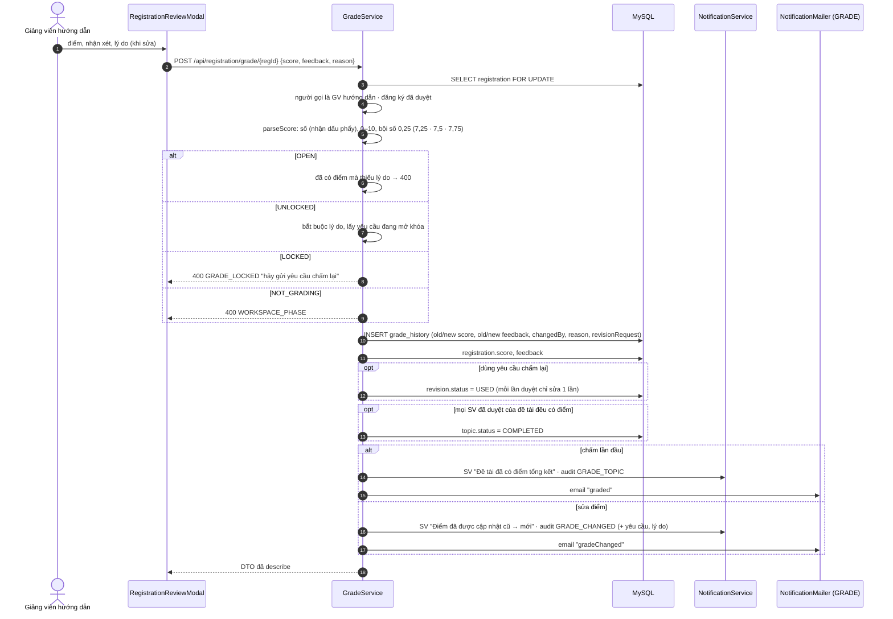
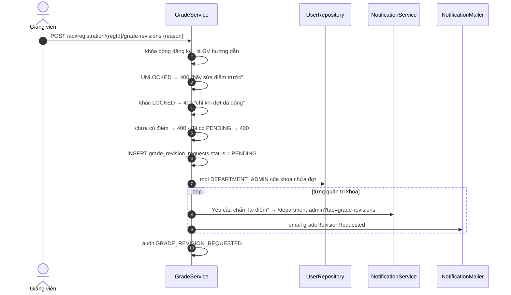
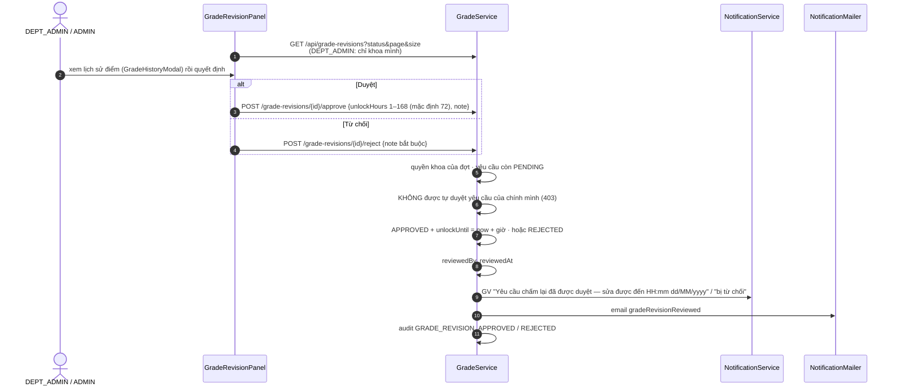
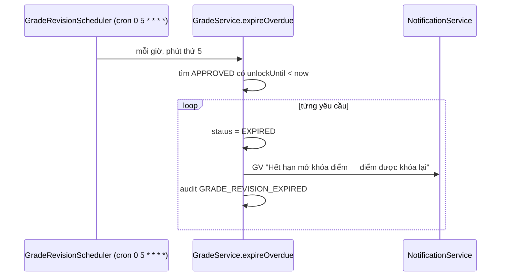
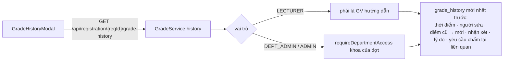
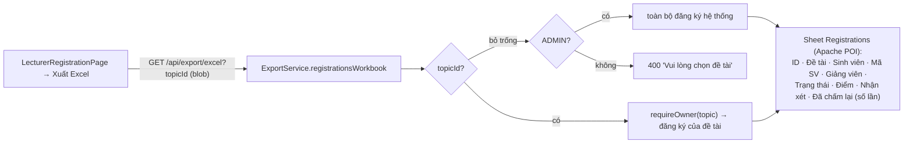

# 08 — Luồng H: Chấm điểm, khóa điểm, chấm lại

[← Mục lục](README.md)

Thành phần chính: `LecturerRegistrationPage` + `RegistrationReviewModal` · `GradeHistoryModal` · `GradeRevisionPanel` (tab "Yêu cầu chấm lại" ở `AdminPage` và `DepartmentAdminPage`) · `GradeService` · `GradeRevisionScheduler` · `ExportService`. Quyết định thiết kế: [ADR-0008](../../docs/adr/0008-khoa-diem-va-cham-lai.md).

## Toàn cảnh

```mermaid
flowchart LR
  subgraph IP["Đợt IN_PROGRESS — GradeState OPEN"]
    G1["GV chấm lần đầu"] --> G2["GV sửa điểm (bắt buộc lý do)"]
  end
  subgraph CL["Đợt CLOSED — GradeState LOCKED"]
    R1["GV gửi yêu cầu chấm lại + lý do"] --> R2{"Khoa / ADMIN xét"}
    R2 -->|"duyệt, mở khóa 1–168 giờ"| UN["GradeState UNLOCKED"]
    R2 -->|"từ chối"| LK["vẫn LOCKED"]
    UN -->|"GV sửa 1 lần (bắt buộc lý do)"| US["yêu cầu USED → LOCKED"]
    UN -->|"quá hạn (job mỗi giờ)"| EX["yêu cầu EXPIRED → LOCKED"]
  end
  IP -->|"transition CLOSED"| CL
  G1 & G2 & US --> HIS[("grade_history<br/>mọi lần lưu điểm")]
```

## H1. Trạng thái chấm điểm (tính động)

```mermaid
flowchart TB
  IN["GradeService.gradeState(reg, now)"] --> W{"trạng thái đợt"}
  W -->|"IN_PROGRESS"| OPEN["OPEN — chấm / sửa tự do"]
  W -->|"CLOSED"| A{"có yêu cầu APPROVED<br/>và unlockUntil > now?"}
  A -->|"có"| UNL["UNLOCKED"]
  A -->|"không"| LCK["LOCKED"]
  W -->|"khác"| NG["NOT_GRADING — chưa đến giai đoạn chấm"]
  OPEN & UNL & LCK & NG --> DTO["TopicRegistrationDTO.gradeState<br/>(+ scoreRevisedAt; với người xét: scoreRevisionCount, latestRevision)"]
  DTO --> UI["RegistrationReviewModal bật/tắt ô điểm, nút 'Yêu cầu chấm lại'"]
```

## H2 · H3. Chấm / sửa điểm tổng kết

## H4. Giảng viên gửi yêu cầu chấm lại

## H5. Khoa / ADMIN duyệt hoặc từ chối

## H6. Tự khóa lại khi hết hạn mở khóa

## H7. Lịch sử điểm

Nhật ký kiểm toán nhóm `GRADE_*` **không bị xóa** bởi chính sách lưu trữ 12 tháng (K4).

## H8. Xuất Excel danh sách đăng ký & điểm

