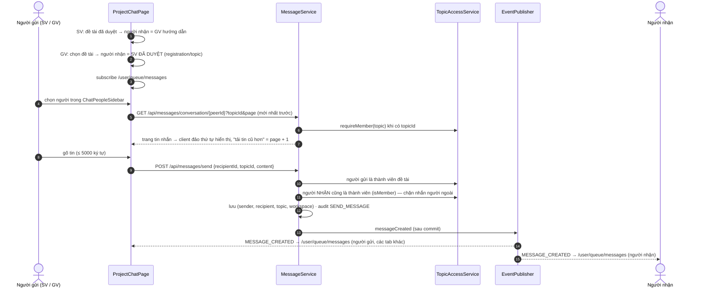
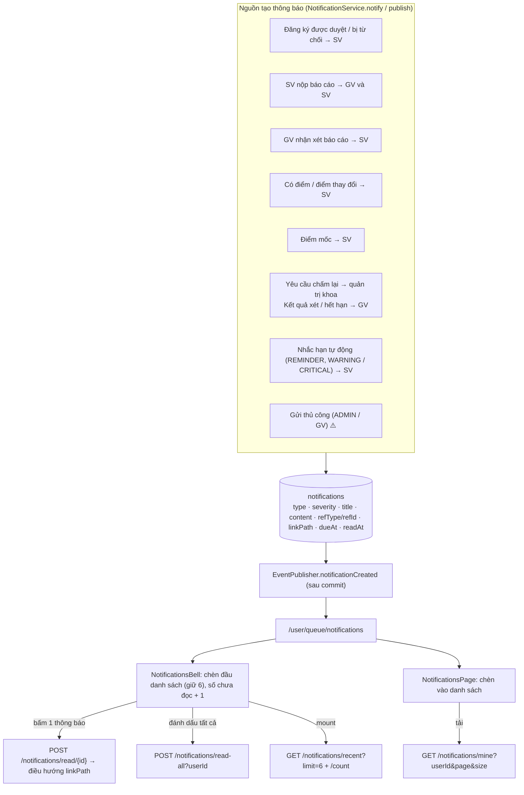
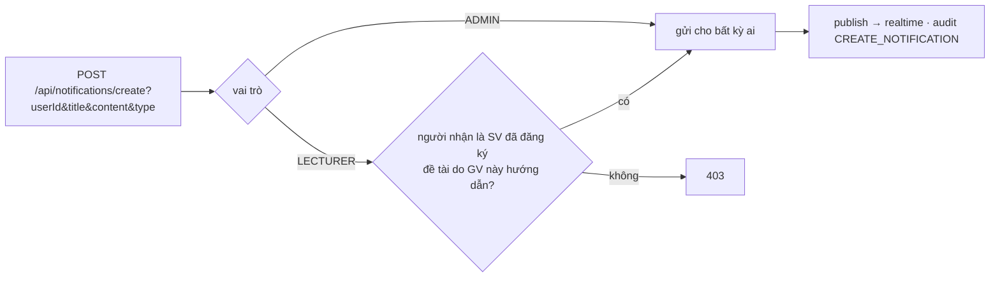
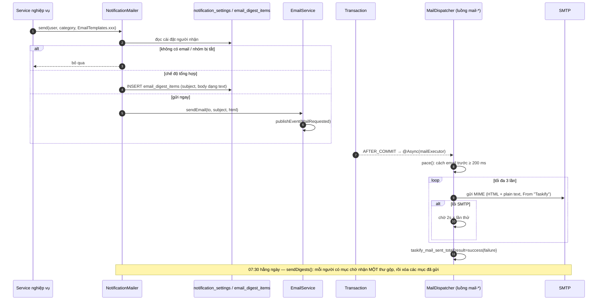
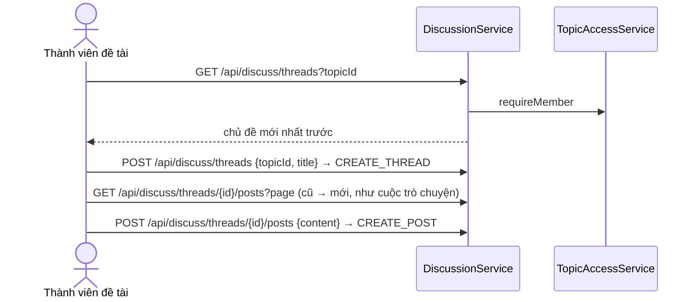
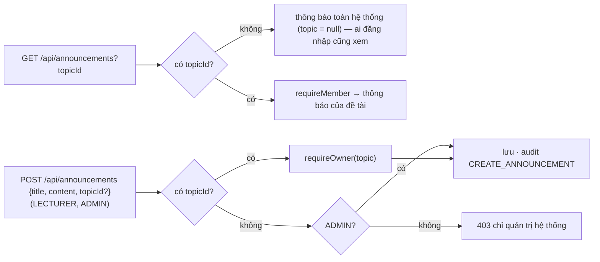
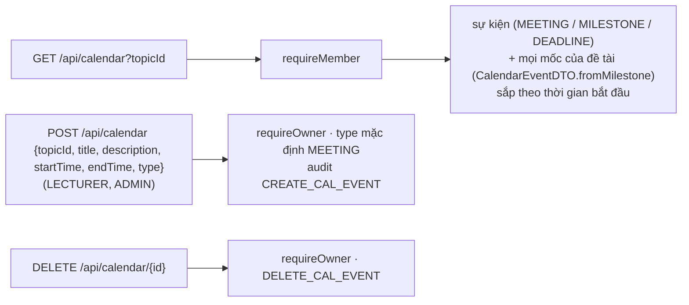

# 09 — Luồng I: Giao tiếp, thông báo, email

[← Mục lục](README.md)

Thành phần chính: `ProjectChatPage` (`ChatPeopleSidebar`, `ChatConversation`) · `NotificationsBell` · `NotificationsPage` · `NotificationSettingsTab` · `MessageService` · `NotificationService` · `NotificationMailer` · `EmailService` · `MailDispatcher` · `EmailTemplates` · `DiscussionService` · `AnnouncementService` · `CalendarService` · `EventPublisher`.

## I1. Tin nhắn 1–1 trong phạm vi đề tài

`GET /api/messages/inbox` (danh sách hội thoại gần nhất) có API, giao diện hiện chưa dùng.

## I2. Thông báo trong ứng dụng

Đọc thông báo: mọi vai trò chỉ đọc của **chính mình** (bỏ qua `userId` gửi lên); chỉ ADMIN xem được thông báo người khác. `markRead`: chỉ chủ thông báo hoặc ADMIN.

### I3. Gửi thông báo thủ công (API, chưa có UI)

## I4 · I5 · I6. Email: gửi ngay, tổng hợp hằng ngày, hạ tầng gửi

Danh mục mẫu email (`EmailTemplates`):

| Nhóm | Mẫu | Người nhận |
|---|---|---|
| Bảo mật (luôn gửi) | `loginOtp`, `activation`, `resetPassword` | chính người dùng |
| `REGISTRATION` | `registrationApproved`, `registrationRejected` | SV |
| `PROGRESS` | `progressSubmitted` | GV |
| `PROGRESS` | `progressFeedback` | SV |
| `GRADE` | `graded`, `gradeChanged` | SV |
| `GRADE` | `gradeRevisionRequested` | quản trị khoa |
| `GRADE` | `gradeRevisionReviewed` | GV |
| `REMINDER` | `progressReminder`, `milestoneReminder` | SV |
| (tổng hợp) | `digest` | người bật chế độ tổng hợp |

## I7. Thảo luận nhóm theo chủ đề (API, chưa có UI)

## I8. Thông báo chung — announcements (API, chưa có UI)

## I9. Lịch đề tài (API, chưa có UI)

