# 10 — Luồng J · K: Dashboard, thống kê, kiểm toán, vận hành

[← Mục lục](README.md)

Thành phần chính: `DashboardPage` (`LecturerSection`, `StudentSection`, `OverviewSection`, `charts`) · `StatsTab` · `AuditLogPage` (`AuditFilters`, `AuditTable`) · `DashboardService` · `DashboardOverviewService` · `DashboardQueryRepository` · `AuditLogService` · `AuditLogQueryService` · `ReminderService` · `RateLimiter` · `RequestIdFilter` · `AppMetrics`.

---

# J. Dashboard & thống kê

## Trang Tổng quan chọn nội dung theo vai trò

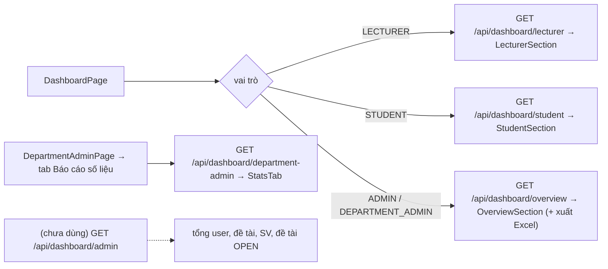

## J1. Dashboard giảng viên

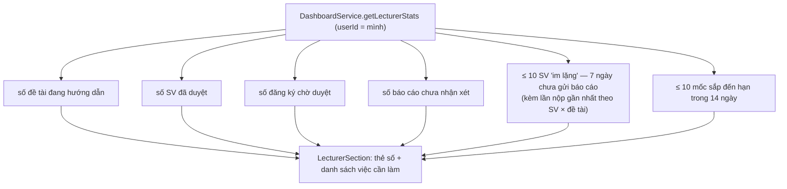

## J2. Dashboard sinh viên

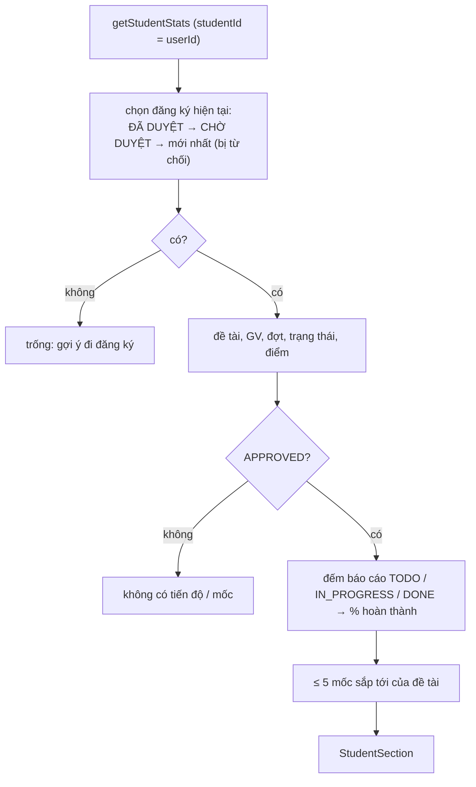

## J3. Thống kê tổng hợp (ADMIN / quản trị khoa)

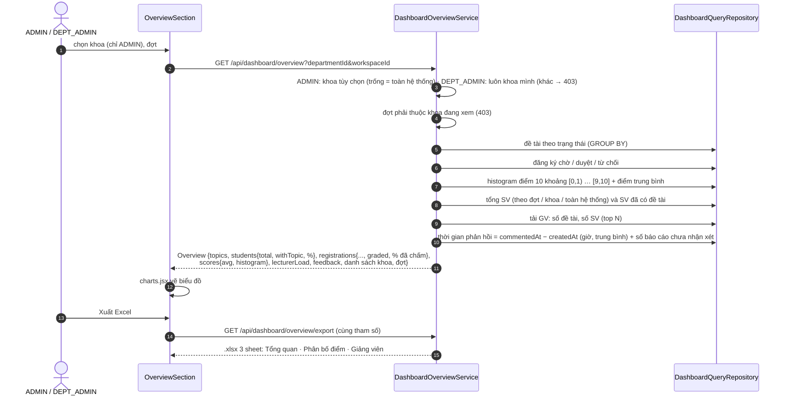
Mọi số liệu là truy vấn `COUNT` / `GROUP BY` (dựa vào index V5), không cache.

## J4. Số liệu nhanh của khoa

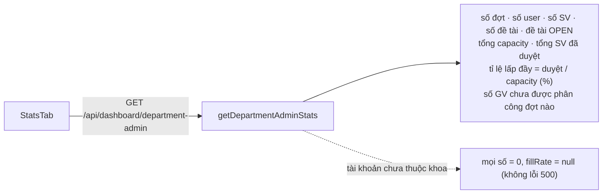

---

# K. Kiểm toán & vận hành

## K1. Ghi nhật ký kiểm toán

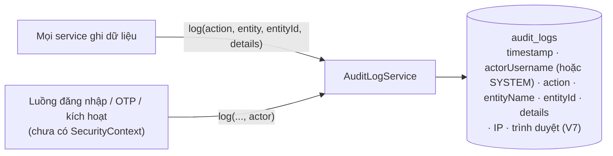

Các nhóm mã hành động:

| Nhóm (bộ lọc) | Ví dụ mã |
|---|---|
| `AUTH` | `LOGIN_SUCCESS`, `LOGIN_FAILED`, `LOGIN_LOCKED`, `OTP_FAILED`, `OTP_LOCKED`, `LOGOUT_ALL`, `PASSWORD_INITIAL_SET`, `PASSWORD_RESET_REQUESTED/DONE/FAILED`, `ACTIVATE_ACCOUNT`, `ACTIVATION_FAILED`, `REFRESH_TOKEN_REUSE`, `CHANGE_PASSWORD` |
| `ACCOUNT` | `CREATE_USER`, `UPDATE_USER_ROLE`, `LOCK_USER`, `UNLOCK_USER`, `UPDATE_PROFILE`, `RESEND_ACTIVATION`, `IMPORT_USERS`, `BOOTSTRAP_ADMIN`, `CREATE_ROLE`, `UPDATE_ROLE`, `DELETE_ROLE`, `CREATE_PRIVILEGE` |
| `GRADE` (giữ vĩnh viễn) | `GRADE_TOPIC`, `GRADE_CHANGED`, `GRADE_MILESTONE`, `GRADE_REVISION_REQUESTED/APPROVED/REJECTED/EXPIRED` |
| khác | `CREATE/UPDATE/TRANSITION_WORKSPACE`, `ASSIGN/UNASSIGN_CLASS_*`, `ASSIGN_LECTURER`, `REVOKE_LECTURER_ASSIGNMENT`, `CREATE/UPDATE/DELETE_TOPIC`, `REGISTER_TOPIC`, `APPROVE/REJECT/CANCEL_REGISTRATION`, `CREATE_PROGRESS`, `UPDATE_PROGRESS(_STATUS)`, `SIMILARITY_ALERT`, `CREATE/UPDATE/DELETE_MILESTONE`, `SEND_MESSAGE`, `CREATE_THREAD`, `CREATE_POST`, `CREATE_ANNOUNCEMENT`, `CREATE/DELETE_CAL_EVENT`, `CREATE_NOTIFICATION`, `CREATE/UPDATE_DEPARTMENT`, `ENABLE/DISABLE_DEPARTMENT`, `CREATE/UPDATE_CLASS`, `SYSTEM_REMINDER` |

## K2. Tra cứu & xuất nhật ký (ADMIN)

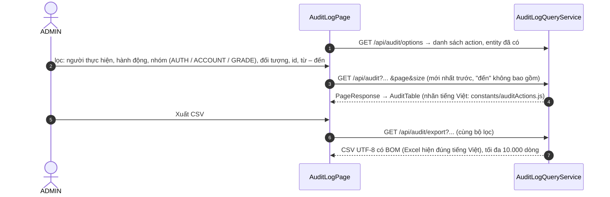
`GET /api/audit/recent` có API, chưa có UI. Chính sách lưu trữ: job 03:45 xóa bản ghi cũ hơn `APP_AUDIT_RETENTION_MONTHS` (mặc định 12) **trừ** `GRADE_*`.

## K3. Nhắc hạn tự động

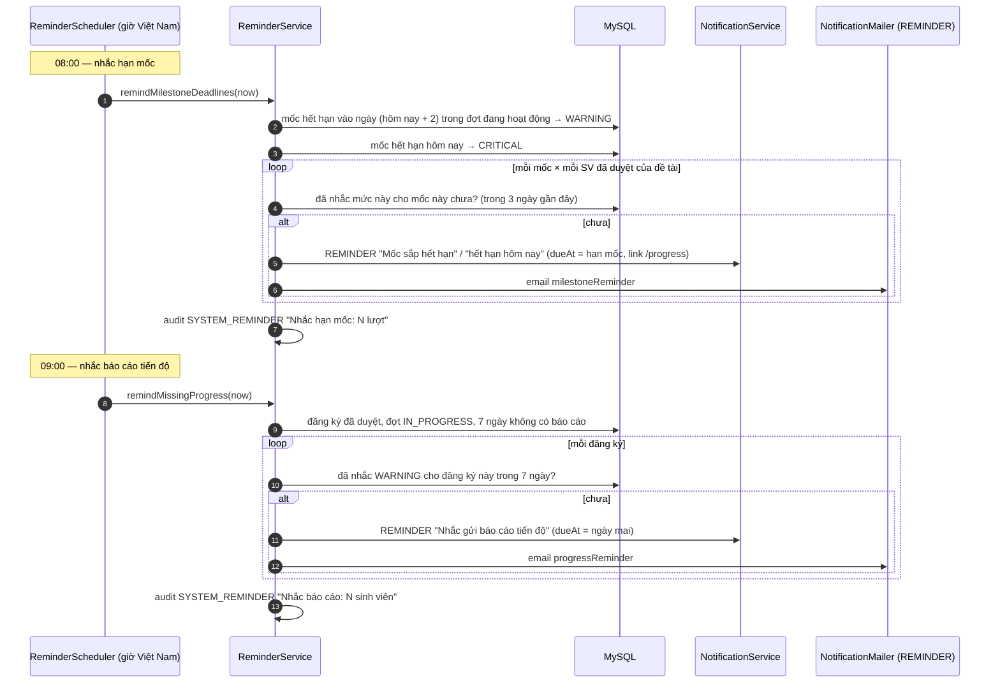

## K4. Dọn dẹp định kỳ

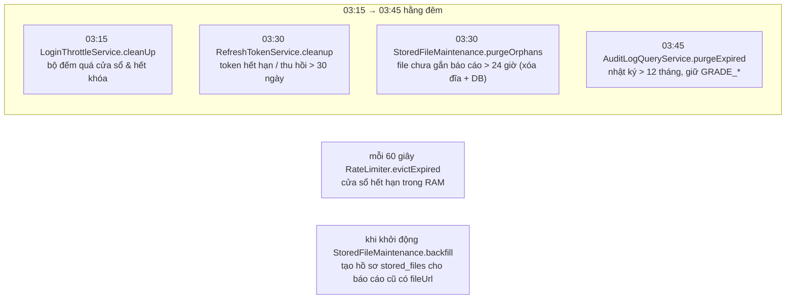

## K5. Giới hạn tần suất

| Nhóm (`bucket`) | Khóa | Giới hạn mặc định | Biến môi trường |
|---|---|---|---|
| `login` | IP | 10 / phút | `APP_RATE_LOGIN_PER_MINUTE` |
| `otp-verify`, `pwd-initial` | IP | 10 / phút | `APP_RATE_OTP_VERIFY_PER_MINUTE` |
| `otp-resend` | IP | 5 / 10 phút | `APP_RATE_OTP_RESEND_PER_10_MINUTES` |
| `activate` | IP | 10 / 10 phút | `APP_RATE_ACTIVATE_PER_10_MINUTES` |
| `pwd-reset-ip` / `pwd-reset-id` | IP / định danh | 10 / 15 phút · 3 / 15 phút | (hằng số) |
| `refresh` | IP | 300 / phút | `APP_RATE_REFRESH_PER_MINUTE` |
| `upload` | user id | 30 / 10 phút | `APP_RATE_UPLOAD_PER_10_MINUTES` |
| Khóa đăng nhập (DB) | SHA-256(username\|IP) | 5 lần sai / 15 phút → khóa 10 phút | `APP_LOGIN_MAX_FAILURES`, `_WINDOW_MINUTES`, `_LOCK_MINUTES` |
| Gửi lại OTP / kích hoạt | (user, mục đích) | 60 giây giữa 2 mã | (hằng số) |

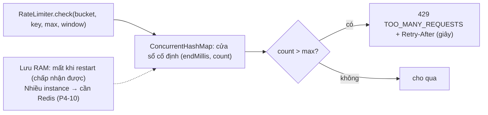

## K6. Lỗi chuẩn hiển thị ở giao diện

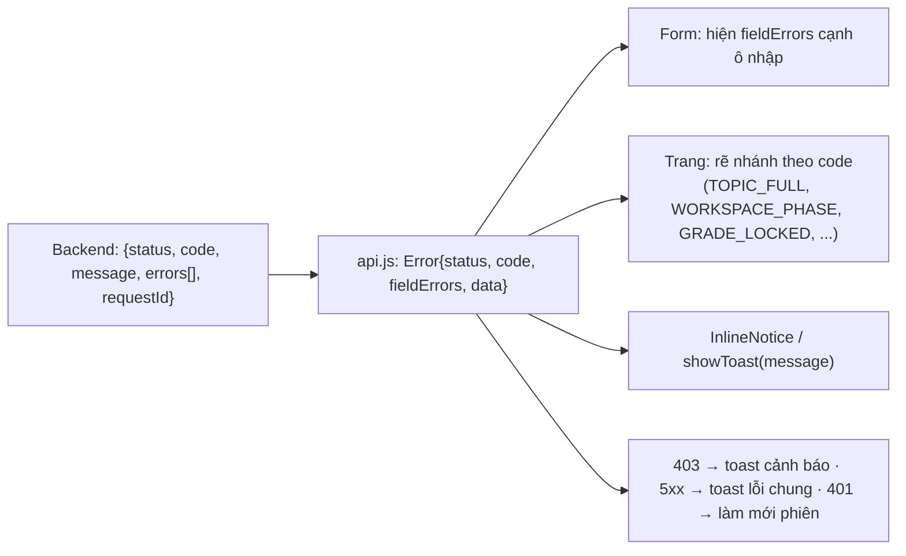

## K7. Quan sát & cảnh báo

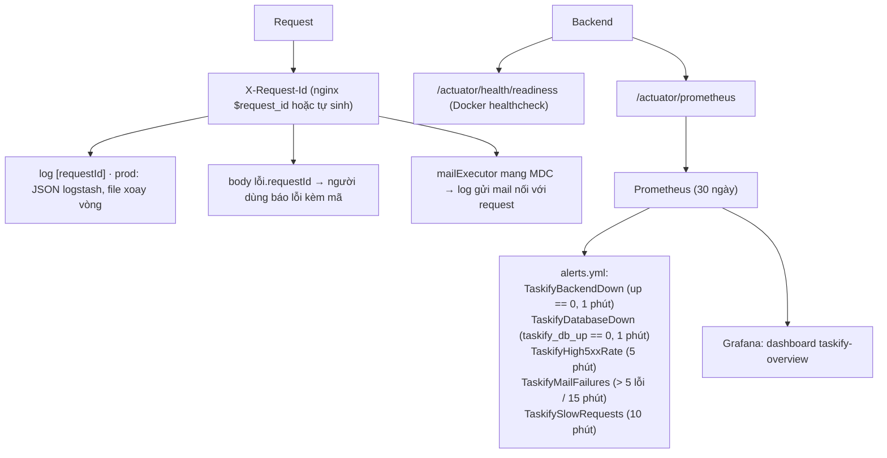

## K8. CI/CD & kiểm thử

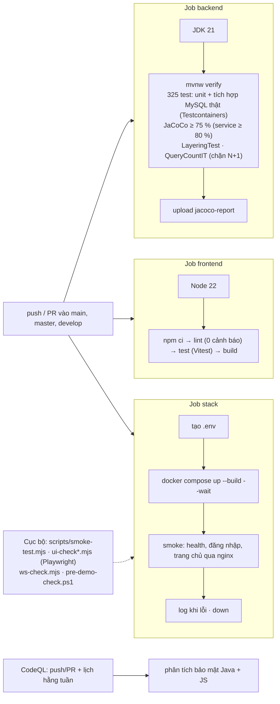
