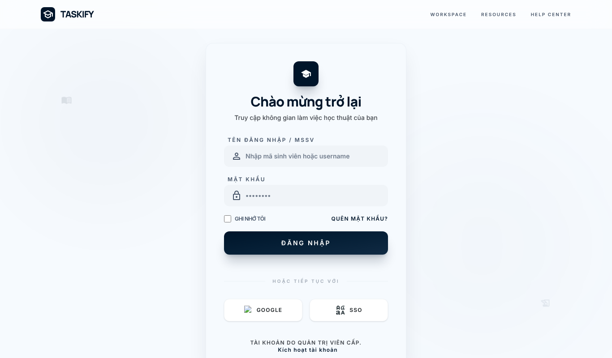
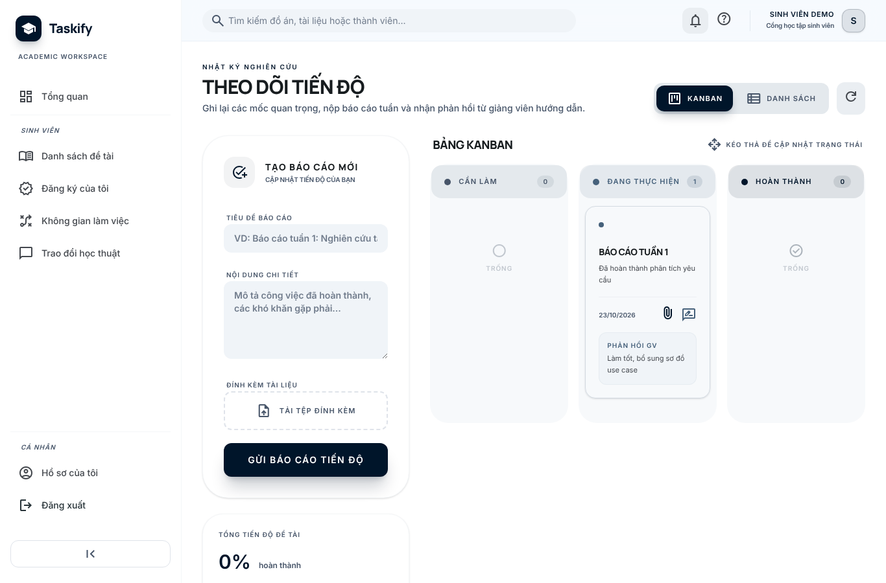
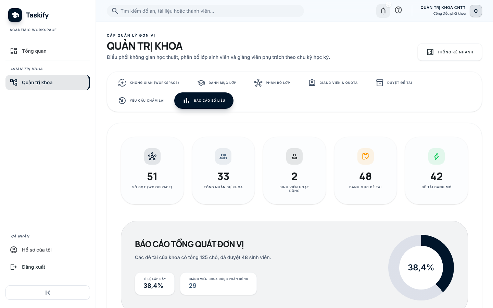
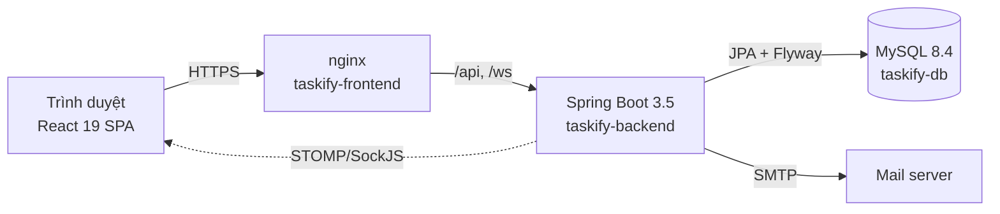

# Taskify — Hệ thống quản lý đề tài và tiến độ đồ án

[](https://github.com/NguyenTanSang2210/Taskify/actions/workflows/CI.yml)
[](https://github.com/NguyenTanSang2210/Taskify/actions/workflows/codeql.yml)
-brightgreen)
  

Taskify hỗ trợ khoa, giảng viên và sinh viên quản lý trọn vòng đời đồ án: mở đợt, ra đề tài, đăng ký – duyệt, theo dõi tiến độ theo mốc, trao đổi realtime và chấm điểm (có khóa điểm và quy trình chấm lại).

| Đăng nhập (OTP 2 bước cho vai trò quản trị) | Kanban tiến độ của sinh viên | Báo cáo số liệu của khoa |
|---|---|---|
|  |  |  |

## 1. Vai trò và chức năng

| Vai trò | Làm được gì |
|---|---|
| `ADMIN` | Quản lý tài khoản, vai trò & quyền, khoa; thông báo toàn hệ thống; xem nhật ký kiểm toán; duyệt yêu cầu chấm lại |
| `DEPARTMENT_ADMIN` | Quản lý đợt đồ án (workspace) và vòng đời của đợt, lớp, phân công giảng viên + quota, duyệt đề tài, báo cáo số liệu khoa |
| `LECTURER` | Ra đề tài, duyệt đăng ký, chấm điểm (cả theo mốc), nhận xét tiến độ, đặt mốc và sự kiện trên lịch học thuật, nhắn tin/thảo luận nhóm với sinh viên |
| `STUDENT` | Đăng ký đề tài trong đợt của lớp mình, nộp báo cáo tiến độ (Kanban) và bài theo mốc, xem lịch học thuật, thảo luận nhóm, nhận phản hồi, trao đổi với giảng viên |

Chi tiết từng quy trình: [`documentation_vận_hành.md`](documentation_vận_hành.md). Ma trận phân quyền: [`docs/SECURITY.md`](docs/SECURITY.md).

## 2. Kiến trúc



- **Backend** (`Backend/`): REST API + WebSocket (STOMP), Spring Security (JWT 15 phút + refresh token xoay vòng trong cookie HttpOnly), Bean Validation, Flyway, Actuator.
- **Frontend** (`frontend/`): React 19 + Vite + Tailwind, route tải lười (lazy), mọi lời gọi API qua `src/api/*`.
- **Hạ tầng**: Docker Compose (3 container `taskify-db`, `taskify-backend`, `taskify-frontend`) có healthcheck.

Tài liệu kỹ thuật: [`docs/ARCHITECTURE.md`](docs/ARCHITECTURE.md) (sơ đồ thành phần, ERD, vòng đời trạng thái) · [`docs/TECHNICAL_REPORT.md`](docs/TECHNICAL_REPORT.md) · [`docs/error-codes.md`](docs/error-codes.md) (định dạng lỗi API) · [`docs/adr/`](docs/adr/) (các quyết định kiến trúc) · [`docs/DEPLOYMENT.md`](docs/DEPLOYMENT.md).

## 3. Cấu trúc thư mục

```text
Taskify/
  Backend/            # Spring Boot (Java 21): controller → service → repository, db/migration (Flyway)
  frontend/           # React + Vite: pages/, components/, api/, hooks/, layouts/, routes/
  docs/               # Tài liệu kỹ thuật, ADR, ảnh chụp màn hình
  scripts/            # Script tạo .env, chạy nhanh, smoke test, kiểm thử giao diện
  Plan/               # Kế hoạch phát triển và báo cáo theo giai đoạn
  docker-compose.yml  # Chạy toàn bộ hệ thống
  .env.docker.example # Mẫu biến môi trường cho Docker
```

## 4. Chạy nhanh bằng Docker (khuyến nghị)

Yêu cầu: Docker Desktop (hoặc Docker Engine + Compose v2).

```powershell
# Tạo .env và Backend/.env với JWT_SECRET + mật khẩu MySQL ngẫu nhiên (không ghi đè file đã có).
# Mặc định profile dev + dữ liệu demo; thêm -Profile prod khi triển khai thật, -OtpEmail ban@gmail.com để nhận OTP demo.
.\scripts\init-env.ps1

docker compose up --build -d --wait   # --wait: chờ tới khi backend "healthy"
```

| Thành phần | Địa chỉ mặc định | Đổi cổng bằng biến |
|---|---|---|
| Giao diện | http://localhost:5175 | `FRONTEND_HOST_PORT` |
| API | http://localhost:8081/api | `BACKEND_HOST_PORT` |
| Health | http://localhost:8081/actuator/health/readiness | — |
| MySQL | `localhost:3307` | `MYSQL_HOST_PORT` |
| Prometheus / Grafana (tùy chọn) | http://127.0.0.1:9090 · http://127.0.0.1:3000 — `docker compose --profile monitoring up -d` | `PROMETHEUS_HOST_PORT`, `GRAFANA_HOST_PORT` |

> **Bắt buộc:** `JWT_SECRET`, `MYSQL_PASSWORD`, `MYSQL_ROOT_PASSWORD` không có giá trị mặc định — thiếu thì `docker compose` từ chối chạy, và profile `prod` không khởi động với secret công khai trong repo. Tự tạo `.env` bằng tay (`Copy-Item .env.docker.example .env`) thì phải điền đủ ba giá trị này.

> **Cookie phiên đăng nhập:** ở profile `prod` cookie refresh có cờ `Secure`, nên phải truy cập qua **HTTPS** (xem `docs/DEPLOYMENT.md`). Chạy thử qua `http://` bằng IP LAN thì đặt `APP_AUTH_REFRESH_COOKIE_SECURE=false` (`init-env.ps1` tự đặt như vậy cho profile `dev`).

**Tài khoản demo** (profile `dev` + `APP_SEED_ENABLED=true`), mật khẩu `123456`:

| Tài khoản | Vai trò | Ghi chú |
|---|---|---|
| `admin` | ADMIN | cần OTP (gửi tới `APP_SEED_OTP_EMAIL`, hoặc lấy bằng `.\scripts\get-otp.ps1 admin`) |
| `deptadmin` | DEPARTMENT_ADMIN | cần OTP |
| `lecturer` | LECTURER | cần OTP |
| `student`, `student2` | STUDENT | lớp CNTT-K15 |

Lệnh thường dùng:

```powershell
docker compose ps                  # backend phải ở trạng thái (healthy)
docker compose logs -f backend
docker compose down                # dừng, giữ dữ liệu
docker compose down -v             # dừng + XÓA dữ liệu DB (cẩn thận)
```

## 5. Chạy từng phần khi phát triển

Yêu cầu: Java 21, Node.js ≥ 22.12, MySQL 8 (hoặc dùng MySQL trong compose: `docker compose up -d db`).

```powershell
.\scripts\run-backend.ps1     # backend local, đọc Backend/.env (http://localhost:8080)
.\scripts\run-frontend.ps1    # Vite dev server http://localhost:5175 (proxy /api, /ws)
```

Hoặc chạy trực tiếp: `cd Backend; .\mvnw.cmd spring-boot:run` và `cd frontend; npm ci; npm run dev`.

Schema do **Flyway** quản lý (`Backend/src/main/resources/db/migration`, `ddl-auto=validate`). Thay đổi schema = thêm file `V<n>__mo_ta.sql` mới, không sửa migration đã phát hành. **Sao lưu DB trước khi nâng cấp** (lệnh ở `docs/DEPLOYMENT.md`).

## 6. Kiểm thử và chất lượng

| Lệnh | Làm gì |
|---|---|
| `cd Backend; .\mvnw.cmd verify` | 361 test (unit + tích hợp trên MySQL thật qua **Testcontainers** — cần Docker; hoặc dùng MySQL có sẵn qua `DB_URL`) + kiểm tra ngưỡng JaCoCo. Báo cáo: `Backend/target/site/jacoco/index.html` |
| `cd frontend; npm run check` | `lint` (0 cảnh báo) → `test` (Vitest + Testing Library) → `build` |
| `node scripts/smoke-test.mjs` | Smoke test toàn luồng nghiệp vụ trên stack Docker profile dev |
| `node scripts/ui-check*.mjs` | Kiểm thử giao diện bằng Playwright (đăng nhập theo vai trò, phân trang, realtime, quét mọi trang/tab) |
| `node scripts/a11y-check.mjs` | Kiểm tra accessibility WCAG 2.1 AA bằng axe-core trên 21 trang, chế độ sáng và tối (cần `axe-core`, xem đầu file) |
| `.\scripts\pre-demo-check.ps1` | Kiểm tra nhanh trước buổi demo |

CI (GitHub Actions, mỗi push/PR vào `develop`, `main`): backend `verify` + upload báo cáo JaCoCo; frontend lint/test/build; dựng cả stack bằng `docker compose up --wait` rồi gọi thử health, đăng nhập và trang chủ qua nginx. CodeQL chạy mỗi tuần.

## 7. Đóng góp

Quy trình nhánh, quy ước commit và checklist trước khi push: [`CONTRIBUTING.md`](CONTRIBUTING.md). Báo lỗ hổng bảo mật: [`docs/SECURITY.md`](docs/SECURITY.md).

Lộ trình và tiến độ: [`Plan/plan1.md`](Plan/plan1.md).
