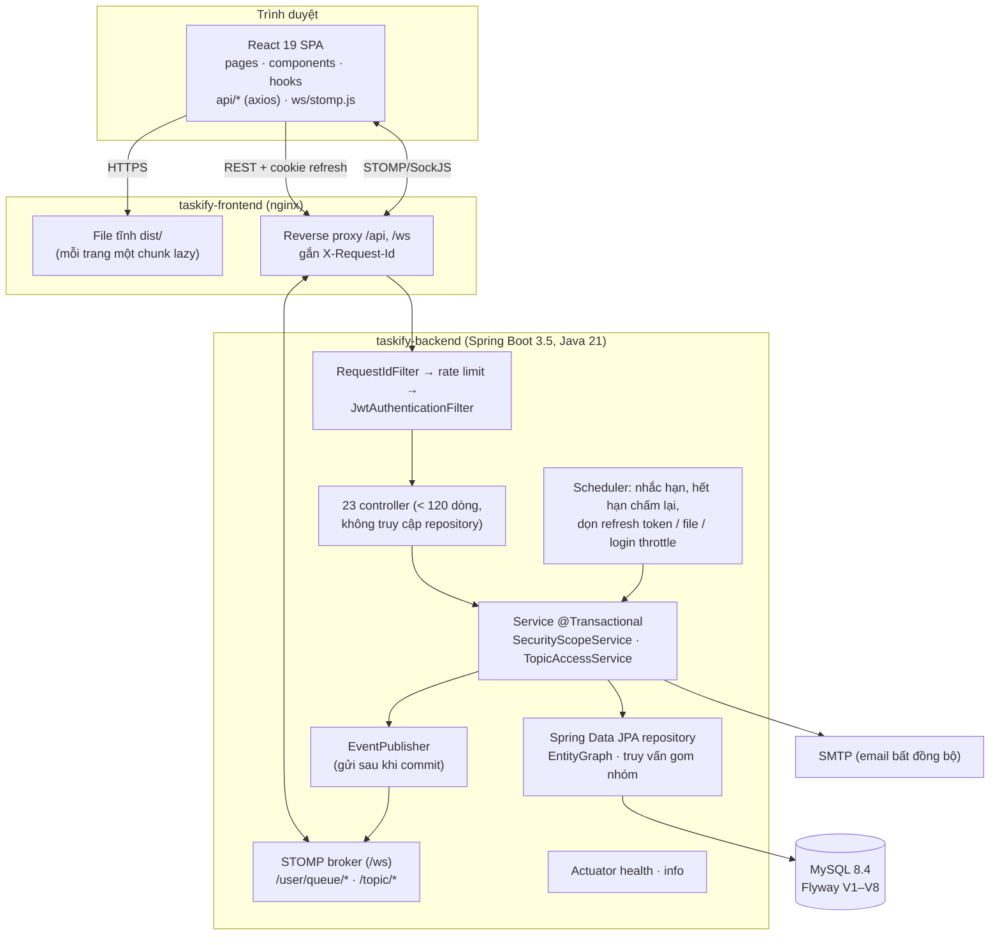
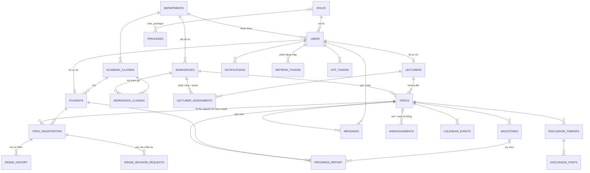
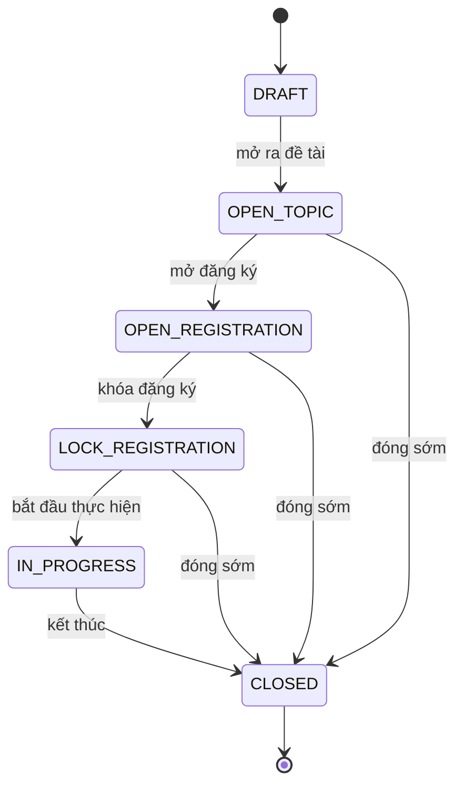
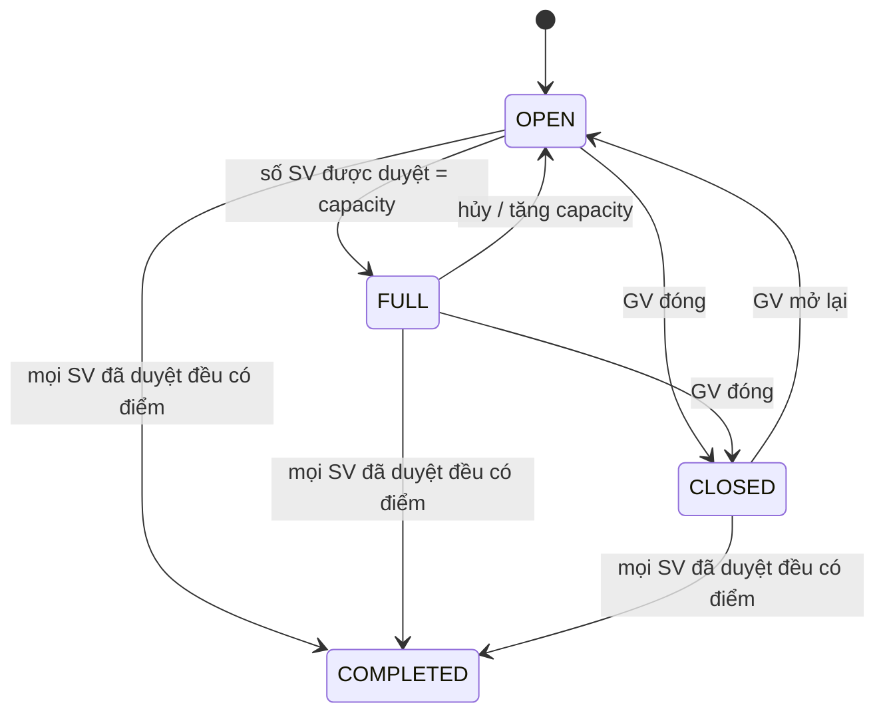
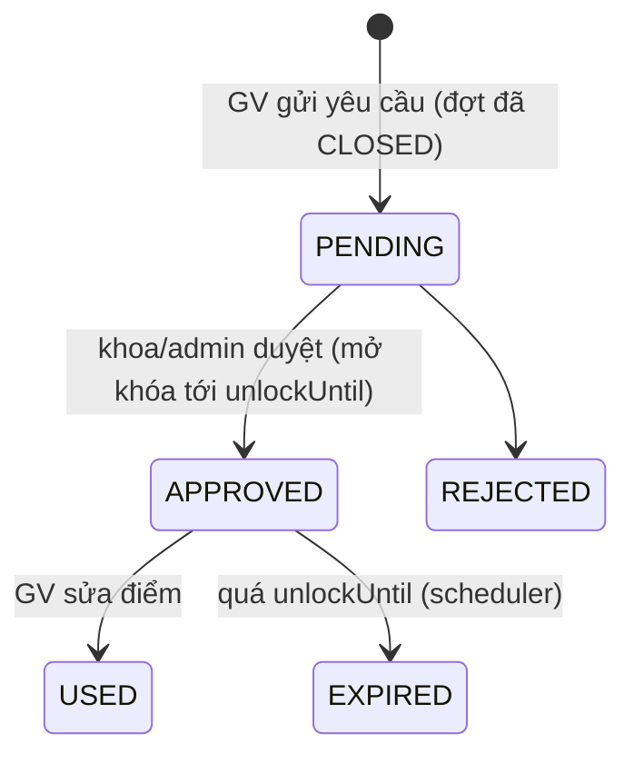
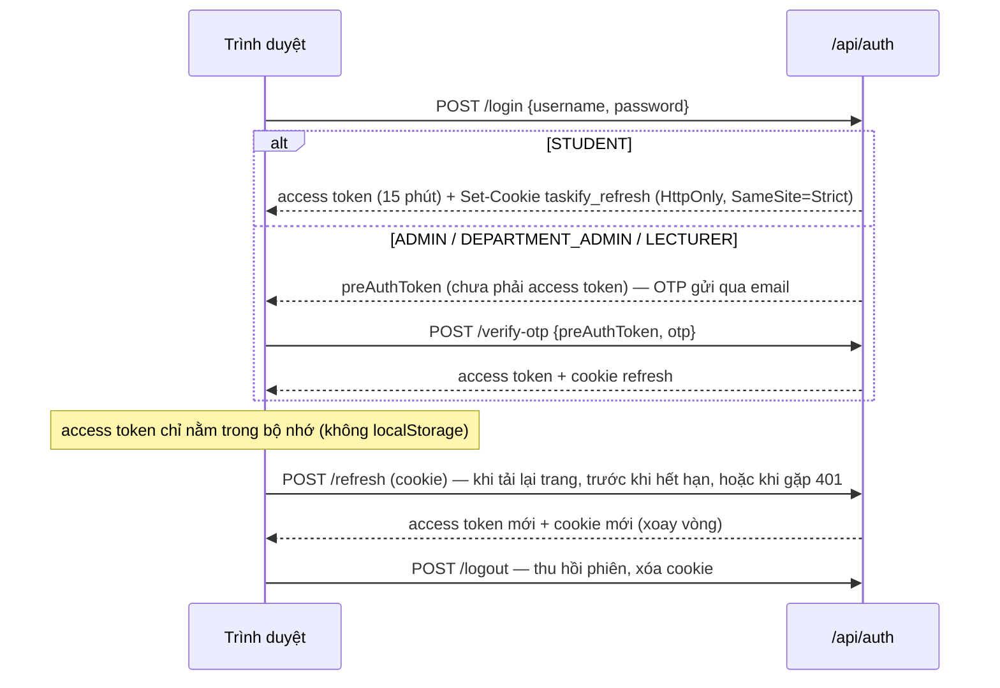

# Kiến trúc Taskify

Tài liệu mô tả cấu trúc hệ thống ở thời điểm kết thúc Giai đoạn 3 (v0.4.0-hardening). Các quyết định nền tảng được ghi ở [`docs/adr/`](adr/).

## 1. Sơ đồ thành phần

### Phân tầng backend

| Tầng | Gói | Quy tắc |
|---|---|---|
| Web | `controller`, `dto/request`, `dto/response` | Nhận record request đã `@Valid`, gọi service, trả DTO. Không inject repository; tối đa 120 dòng (`LayeringTest` kiểm tra tự động). |
| Nghiệp vụ | `service` | Mọi thao tác ghi nằm trong `@Transactional`; GET dùng `readOnly`. Kiểm tra phạm vi dữ liệu qua `SecurityScopeService` (khoa) và `TopicAccessService` (đề tài). |
| Dữ liệu | `repository`, `entity`, `entity/enums` | Trạng thái là enum (`@Enumerated(STRING)`); quy tắc chuyển trạng thái nằm trong enum. |
| Hạ tầng | `config`, `security`, `exception`, `scheduler` | Định dạng lỗi chung (`GlobalExceptionHandler`, `ApiException`, `ErrorCodes`), JWT + refresh cookie, CORS, log có request id. |

`spring.jpa.open-in-view=false`: dữ liệu lazy phải được nạp trong service (EntityGraph hoặc truy vấn gom nhóm). `QueryCountIT` giữ ngân sách số truy vấn của các endpoint danh sách để chặn N+1.

### Frontend

| Thư mục | Vai trò |
|---|---|
| `routes/AppRoutes.jsx` | Khai báo route; mọi trang dùng `React.lazy` + `Suspense` |
| `layouts/AppLayout.jsx`, `components/Sidebar.jsx`, `config/navigation.js` | Khung giao diện, menu theo vai trò (dữ liệu, không lặp JSX) |
| `pages/<Trang>.jsx` + `pages/<trang>/` | Trang lớn tách thành hook dữ liệu (`useXxx.js`) và component từng tab/khối |
| `api/*.js` | Mọi lời gọi HTTP (không trang nào gọi axios trực tiếp) |
| `auth/session.js`, `context/AuthContext.jsx` | Access token trong bộ nhớ, làm mới phiên qua cookie, đồng bộ đăng xuất giữa các tab |
| `ws/stomp.js` | Thư viện STOMP tải lười; lấy token mới nhất mỗi lần kết nối |
| `hooks/useLoadEffect.js` | Tải dữ liệu sau render (không setState đồng bộ trong effect) |

## 2. Mô hình dữ liệu (ERD rút gọn)

Bảng không có khóa ngoại: `audit_logs` (ghi tên người thực hiện), `login_throttle` (chống dò mật khẩu theo tài khoản/IP), `stored_files` (file đã tải lên, xóa mồ côi định kỳ), `data_migrations`, `flyway_schema_history`.

Ghi chú:
- `topic_registration.approved`: `NULL` = chờ duyệt, `1` = đã duyệt, `0` = từ chối. Một đề tài nhận nhiều sinh viên độc lập theo `capacity`, mỗi sinh viên chấm điểm riêng ([ADR-0001](adr/0001-nhieu-sinh-vien-moi-de-tai.md)).
- Thời gian lưu **UTC** trong CSDL, ứng dụng chạy giờ Việt Nam (`Asia/Ho_Chi_Minh`) và trả về giao diện theo giờ Việt Nam.
- Schema chỉ thay đổi qua Flyway (`Backend/src/main/resources/db/migration`): V1 baseline, V2 vai trò/quyền mặc định, V3 sửa dữ liệu GĐ2, V4 enum trạng thái, V5 index truy vấn, V6 refresh token, V7 IP/trình duyệt trong nhật ký hệ thống, V8 thời điểm nhận xét tiến độ.

## 3. Vòng đời trạng thái

### Đợt đồ án (workspace) — `WorkspaceStatus.canTransitionTo`

| Thao tác | Cho phép ở trạng thái |
|---|---|
| Gán lớp, phân công giảng viên | `DRAFT`, `OPEN_TOPIC` |
| Tạo / sửa / xóa đề tài | `OPEN_TOPIC` |
| Đóng / mở lại đề tài | `OPEN_TOPIC`, `OPEN_REGISTRATION` |
| Sinh viên đăng ký | `OPEN_REGISTRATION` |
| Duyệt / từ chối đăng ký | `OPEN_REGISTRATION`, `LOCK_REGISTRATION` |
| Nộp báo cáo tiến độ, chấm điểm | `IN_PROGRESS` |
| Sửa điểm | `CLOSED` chỉ khi có yêu cầu chấm lại đã duyệt, còn hạn |

Vi phạm trả lỗi `WORKSPACE_PHASE` hoặc `INVALID_TRANSITION` ([`error-codes.md`](error-codes.md)).

### Đề tài — `TopicStatus`

`OPEN ↔ FULL` được tính lại sau mỗi lần duyệt/hủy/đổi `capacity` (`Topic.refreshCapacityStatus`); đề tài `CLOSED` hoặc `COMPLETED` giữ nguyên.

### Yêu cầu chấm lại — `GradeRevisionStatus`

## 4. Luồng xác thực

Chi tiết cơ chế bảo vệ: [`SECURITY.md`](SECURITY.md).

## 5. Realtime

| Kênh | Nội dung | Ai nhận |
|---|---|---|
| `/user/queue/notifications` | Thông báo cá nhân | chính người dùng |
| `/user/queue/messages` | Tin nhắn mới | người gửi và người nhận |
| `/topic/progress/{topicId}` | Báo cáo tiến độ thay đổi | GV hướng dẫn, SV của đề tài, khoa |
| `/topic/registration/{topicId}` | Đăng ký thay đổi | GV hướng dẫn, khoa |

Sự kiện được phát **sau khi transaction commit** (`EventPublisher` + `TransactionSynchronization`), nên client không nhận sự kiện của thao tác bị rollback. Quyền đăng ký kênh được kiểm tra khi `SUBSCRIBE` (cùng quy tắc với REST). Broker hiện là broker trong bộ nhớ (một instance backend); mở rộng nhiều instance: P4-10.

## 6. Quan sát hệ thống

- Mỗi request có `X-Request-Id` (nhận từ nginx hoặc tự sinh), có trong log, header phản hồi và body lỗi (`requestId`).
- Profile `prod`: log JSON (logstash) ra console + file xoay vòng trong volume `backend_logs`.
- `GET /actuator/health/readiness` (chỉ phụ thuộc DB) dùng cho healthcheck Docker; `GET /actuator/info` trả phiên bản build.
